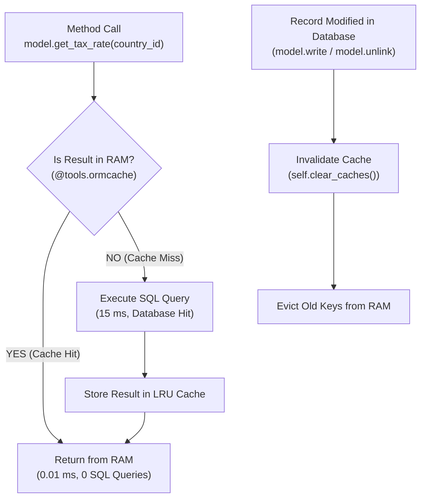

# ORM Cache & Bulk Data Performance Patterns

```
╔══════════════════════════════════════════════════════════════════════════════╗
║  ORM CACHE & BULK DATA PERFORMANCE PATTERNS                                  ║
║  RAM Memoization (@tools.ormcache), Cache Invalidation & Large Dataset Loops ║
║  Official Odoo ORM Cache Architecture & Anti-OOM Best Practices              ║
╚══════════════════════════════════════════════════════════════════════════════╝
```

## 1. Overview of Odoo's In-Memory Cache

Odoo maintains an internal LRU (Least Recently Used) in-memory cache on the worker process. The framework provides decorators in `odoo.tools.cache` to memoize expensive computations, preventing repeated database queries for static or slow-changing data.



---

## 2. Using `@tools.ormcache`

### Basic Memoization Syntax

The arguments passed to `@tools.ormcache()` define the **cache key components**:

```python
from odoo import models, fields, api, tools

class ResCountryTaxRule(models.Model):
    _inherit = 'res.country'

    @tools.ormcache('self.id', 'target_date')
    def get_applicable_vat_rate(self, target_date):
        """Memoize complex fiscal position & tax rates based on country and date.
        
        The result is cached in worker RAM until explicitly invalidated.
        """
        # Complex multi-table query or slow computation
        tax = self.env['account.tax'].search([
            ('country_id', '=', self.id),
            ('date_start', '<=', target_date),
            ('date_end', '>=', target_date),
        ], limit=1)
        return tax.amount if tax else 0.0

    @tools.ormcache('company_id', 'code')
    def get_parameter_value(self, company_id, code):
        """Cache static system configuration parameter."""
        param = self.env['my.system.parameter'].search([
            ('company_id', '=', company_id),
            ('code', '=', code),
        ], limit=1)
        return param.value if param else None
```

### Context-Sensitive Caching (`@tools.ormcache_context`)

When the cached output depends on user language, timezone, or custom context keys:

```python
class ProductTemplate(models.Model):
    _inherit = 'product.template'

    @tools.ormcache_context('self.id', keys=('lang', 'tz'))
    def get_localized_badge_description(self):
        """Result differs depending on the active user's language and timezone."""
        return f"[{self.default_code}] {self.name} - Formatted in {self.env.lang}"
```

---

## 3. Cache Invalidation Rules (`clear_caches`)

Whenever underlying data changes, the cached values become stale and **must be invalidated**:

```python
class ResCountryTaxRule(models.Model):
    _inherit = 'res.country'

    def write(self, vals):
        res = super().write(vals)
        # Invalidate all @tools.ormcache entries across the registry
        self.clear_caches()
        return res

    def unlink(self):
        res = super().unlink()
        self.clear_caches()
        return res
```

> [!WARNING]
> `self.clear_caches()` invalidates **all** `@tools.ormcache` memoizations for the model registry. Do not call it inside loops; call it once after batch updates.

---

## 4. Modern Cache Flushing with Raw SQL (Odoo 16 – 20)

When performing raw SQL `UPDATE`, `CREATE`, or `DELETE`, the ORM cache becomes out-of-sync with database reality. Odoo enforces **Flush & Invalidate**:

```python
def update_product_stock_direct_sql(self, product_ids, new_state):
    """Direct SQL update while preserving ORM cache consistency."""
    # 1. Flush any pending ORM write buffers to DB first
    self.env['product.product'].flush_model(['state'])

    # 2. Execute raw SQL update
    self.env.cr.execute(
        "UPDATE product_product SET state = %s WHERE id IN %s",
        (new_state, tuple(product_ids))
    )

    # 3. Invalidate specific field from ORM cache
    self.env['product.product'].invalidate_model(['state'])
```

For record-specific invalidations:
```python
records = self.env['sale.order'].browse(changed_ids)
records.invalidate_recordset(['amount_total', 'state'])
```

---

## 5. Large-Scale Bulk Processing & Anti-OOM Architecture

When iterating through **tens of thousands or millions of records**, Odoo's `Environment` retains all browsed record instances in memory, inevitably causing worker processes to crash from **Out of Memory (OOM)**.

### The Chunking Generator Pattern

```python
from odoo import models, api

class BulkProcessor(models.Model):
    _name = 'bulk.data.processor'
    _description = 'Large Dataset Processor'

    def process_million_invoices(self, batch_size=1000):
        """Process massive datasets without memory blowup."""
        offset = 0
        domain = [('state', '=', 'draft'), ('move_type', '=', 'out_invoice')]
        
        while True:
            # 1. Fetch only a fixed chunk of IDs
            record_ids = self.env['account.move'].search(
                domain,
                limit=batch_size,
                offset=offset,
                order='id asc'
            ).ids

            if not record_ids:
                break

            # 2. Browse and process batch
            records = self.env['account.move'].browse(record_ids)
            for record in records:
                record._compute_compliance_hash()

            # 3. CRITICAL: Commit transaction to disk
            self.env.cr.commit()

            # 4. CRITICAL: Evict browsed records from Environment memory cache
            self.env.invalidate_all()

            offset += batch_size
```

### Memory Management Checklist for Batch Jobs

| Technique | Purpose | Consequence if Omitted |
|---|---|---|
| `search(..., limit=1000, offset=offset).ids` | Queries only IDs, avoiding loading heavy fields upfront. | Memory spikes from loading full recordsets. |
| `self.env.cr.commit()` | Commits SQL transaction periodically. | Giant uncommitted PostgreSQL transaction locks rows and exhausts connection memory. |
| `self.env.invalidate_all()` | Clears the ORM's active object cache. | Worker memory climbs indefinitely until killed by OOM killer. |
| `records.with_context(prefetch_fields=False)` | Prevents automatic prefetching of adjacent relational fields. | Unintended queries pulling related records into memory. |
