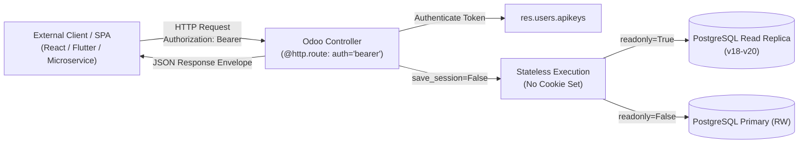

# Modern RESTful API Patterns in Odoo (v16 – v20)

```
╔══════════════════════════════════════════════════════════════════════════════╗
║  MODERN RESTFUL API ARCHITECTURE                                            ║
║  Stateless Bearer Tokens, CORS, Pagination, Standard Envelopes & Readonly   ║
║  Official Odoo HTTP Routing & API Key Integration Standards                 ║
╚══════════════════════════════════════════════════════════════════════════════╝
```

## 1. Overview & Architectural Principles

Modern external integrations (React/Vue SPAs, mobile apps, third-party microservices) require **true stateless RESTful APIs** rather than legacy cookie-based web sessions or raw XML-RPC.



### Key Controller Directives for Modern REST APIs

```python
from odoo import http
from odoo.http import request, Response
import json

@http.route(
    '/api/v1/orders',
    type='http',                  # 'http' allows full control over HTTP headers and status codes
    auth='bearer',                # Validates 'Authorization: Bearer <token>' via res.users.apikeys
    methods=['GET'],              # Strict HTTP verbs
    csrf=False,                   # Stateless API does not require CSRF token
    cors='*',                     # Or specific domain: 'https://app.example.com'
    save_session=False,           # NEVER save session to disk or send session_id cookie
    readonly=True,                # (v18+) Routes query to read-replica database if configured
)
```

---

## 2. Standardized REST Response Envelope

All API endpoints should emit a predictable JSON structure with appropriate HTTP status codes:

```python
import json
from odoo.http import Response

def rest_response(data=None, meta=None, message="Success", status=200):
    """Generate consistent JSON response envelope with proper HTTP status codes."""
    payload = {
        "status": "success" if status < 400 else "error",
        "message": message,
        "data": data,
    }
    if meta:
        payload["meta"] = meta
        
    return Response(
        json.dumps(payload, default=str),
        status=status,
        headers={"Content-Type": "application/json; charset=utf-8"},
    )

def rest_error(message, error_code="BAD_REQUEST", details=None, status=400):
    """Generate standardized error response."""
    payload = {
        "status": "error",
        "error": {
            "code": error_code,
            "message": message,
            "details": details or [],
        }
    }
    return Response(
        json.dumps(payload, default=str),
        status=status,
        headers={"Content-Type": "application/json; charset=utf-8"},
    )
```

---

## 3. Production REST Controller Implementation

```python
from odoo import http, fields
from odoo.http import request
from odoo.exceptions import AccessError, ValidationError
import json

class SaleOrderRestController(http.Controller):

    @http.route(
        '/api/v1/sale_orders',
        type='http',
        auth='bearer',
        methods=['GET'],
        csrf=False,
        cors='*',
        save_session=False,
        readonly=True,
    )
    def list_sale_orders(self, **kwargs):
        """List sales orders with pagination, domain filtering, and field selection."""
        try:
            page = max(1, int(kwargs.get('page', 1)))
            limit = min(100, max(1, int(kwargs.get('limit', 20))))
            offset = (page - 1) * limit

            domain = [('state', 'in', ['sale', 'done'])]
            if kwargs.get('partner_id'):
                domain.append(('partner_id', '=', int(kwargs.get('partner_id'))))

            SaleOrder = request.env['sale.order']
            total_records = SaleOrder.search_count(domain)
            orders = SaleOrder.search(domain, limit=limit, offset=offset, order='date_order desc')

            data = []
            for order in orders:
                data.append({
                    "id": order.id,
                    "name": order.name,
                    "date_order": fields.Datetime.to_string(order.date_order),
                    "partner": {
                        "id": order.partner_id.id,
                        "name": order.partner_id.name,
                    },
                    "amount_total": order.amount_total,
                    "currency": order.currency_id.name,
                    "state": order.state,
                })

            meta = {
                "page": page,
                "limit": limit,
                "total_records": total_records,
                "total_pages": (total_records + limit - 1) // limit,
            }
            return rest_response(data=data, meta=meta)

        except Exception as e:
            return rest_error(str(e), error_code="SERVER_ERROR", status=500)

    @http.route(
        '/api/v1/sale_orders',
        type='http',
        auth='bearer',
        methods=['POST'],
        csrf=False,
        cors='*',
        save_session=False,
    )
    def create_sale_order(self, **kwargs):
        """Create a new sales order from JSON body."""
        try:
            body = json.loads(request.httprequest.data)
            partner_id = body.get('partner_id')
            order_lines = body.get('lines', [])

            if not partner_id or not order_lines:
                return rest_error(
                    "Missing mandatory 'partner_id' or 'lines' payload",
                    error_code="VALIDATION_ERROR",
                    status=422
                )

            lines_vals = []
            for line in order_lines:
                lines_vals.append((0, 0, {
                    'product_id': line['product_id'],
                    'product_uom_qty': line.get('qty', 1.0),
                    'price_unit': line.get('price_unit'),
                }))

            order = request.env['sale.order'].create({
                'partner_id': partner_id,
                'order_line': lines_vals,
            })

            return rest_response(
                data={"id": order.id, "name": order.name, "amount_total": order.amount_total},
                message="Order created successfully",
                status=201,
            )

        except json.JSONDecodeError:
            return rest_error("Invalid JSON body", error_code="INVALID_JSON", status=400)
        except ValidationError as e:
            return rest_error(e.name, error_code="BUSINESS_RULE_ERROR", status=422)
        except AccessError as e:
            return rest_error(str(e), error_code="FORBIDDEN", status=403)
        except Exception as e:
            return rest_error(str(e), error_code="INTERNAL_ERROR", status=500)
```

---

## 4. API Key Programmatic Management (`res.users.apikeys`)

In Odoo 16–20, API keys are managed through `res.users.apikeys`:

```python
class ResUsers(models.Model):
    _inherit = 'res.users'

    def generate_external_service_key(self, service_name, duration_days=365):
        """Programmatically generate a scoped API key for third-party microservice."""
        expiration_date = fields.Date.to_string(
            fields.Date.add(fields.Date.today(), days=duration_days)
        )
        # Generates bearer key with 'rpc' scope
        api_key = self.env['res.users.apikeys'].generate(
            scope='rpc',
            name=f"Service Key: {service_name}",
            expiration_date=expiration_date,
        )
        return api_key
```

---

## 5. Security & Rate Limiting Best Practices

1. **Always Set `save_session=False`**: Prevents persistent session cookies from filling the session storage disk and leaking session IDs across API calls.
2. **Never Run `auth='none'` for Business Data**: Use `auth='bearer'` which automatically enforces record rules and access rights of the linked user.
3. **Use `readonly=True` on Query Endpoints (v18+)**: Enables load-balancing read traffic to PostgreSQL standby replicas.
