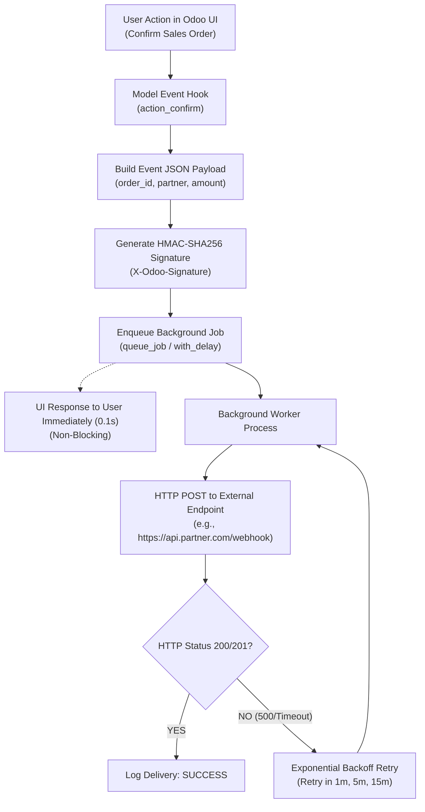

# Outbound Webhook & Event-Driven Patterns in Odoo

```
╔══════════════════════════════════════════════════════════════════════════════╗
║  OUTBOUND WEBHOOK & EVENT-DRIVEN PATTERNS                                    ║
║  Event Triggers, HMAC-SHA256 Signatures, Non-Blocking Async Dispatch         ║
║  Enterprise Integration Architecture & Retry Backoff Handling                ║
╚══════════════════════════════════════════════════════════════════════════════╝
```

## 1. High-Level Event-Driven Architecture

In modern enterprise architectures, external systems (Zapier, Slack, WMS, CRM, Microservices) need **instant event notifications** when state changes occur in Odoo (e.g. `order.confirmed`, `invoice.paid`, `delivery.done`).

Webhooks should **never block the user interface thread**; they must be dispatched asynchronously with cryptographic HMAC signatures.



---

## 2. Cryptographic HMAC Signature Generation

To ensure third-party receiving servers can verify that the webhook payload originated from your genuine Odoo instance and was not intercepted/tampered with:

```python
import hmac
import hashlib
import json
import time

def generate_webhook_signature(payload_str, secret_key):
    """Generate SHA-256 HMAC signature string."""
    signature = hmac.new(
        secret_key.encode('utf-8'),
        payload_str.encode('utf-8'),
        hashlib.sha256
    ).hexdigest()
    return signature

def build_signed_headers(payload_str, secret_key):
    """Build standard enterprise webhook security headers."""
    timestamp = str(int(time.time()))
    # Prepend timestamp to prevent replay attacks
    signed_payload = f"{timestamp}.{payload_str}"
    signature = generate_webhook_signature(signed_payload, secret_key)
    
    return {
        "Content-Type": "application/json",
        "X-Odoo-Timestamp": timestamp,
        "X-Odoo-Signature": f"v1={signature}",
    }
```

---

## 3. Webhook Subscription & Delivery Logging Model

```python
from odoo import models, fields, api, _
import requests
import json
import logging

_logger = logging.getLogger(__name__)

class WebhookSubscription(models.Model):
    _name = 'webhook.subscription'
    _description = 'Outbound Webhook Subscription'

    name = fields.Char(string='Subscription Name', required=True)
    target_url = fields.Char(string='Endpoint URL', required=True)
    secret_key = fields.Char(string='HMAC Secret Key', required=True)
    event_type = fields.Selection([
        ('sale_order_confirmed', 'Sale Order Confirmed'),
        ('invoice_paid', 'Customer Invoice Paid'),
        ('picking_done', 'Delivery Order Completed'),
    ], string='Event Trigger', required=True)
    active = fields.Boolean(default=True)
    log_ids = fields.One2many('webhook.delivery.log', 'subscription_id', string='Delivery Logs')


class WebhookDeliveryLog(models.Model):
    _name = 'webhook.delivery.log'
    _description = 'Outbound Webhook Delivery Log'
    _order = 'create_date desc'

    subscription_id = fields.Many2one('webhook.subscription', required=True, ondelete='cascade')
    payload = fields.Text(string='Payload JSON')
    response_code = fields.Integer(string='HTTP Status')
    response_body = fields.Text(string='Response Body')
    state = fields.Selection([
        ('success', 'Delivered'),
        ('failed', 'Failed'),
    ], string='Status', required=True)
```

---

## 4. Asynchronous Non-Blocking Dispatch (OCA `queue_job`)

Hook into model business methods and dispatch webhooks asynchronously using OCA `queue_job`:

```python
class SaleOrder(models.Model):
    _inherit = 'sale.order'

    def action_confirm(self):
        """Confirm order and dispatch non-blocking webhook."""
        res = super().action_confirm()
        for order in self:
            order._dispatch_order_confirmed_webhooks()
        return res

    def _dispatch_order_confirmed_webhooks(self):
        """Find active subscriptions and queue asynchronous delivery jobs."""
        subscriptions = self.env['webhook.subscription'].search([
            ('event_type', '=', 'sale_order_confirmed'),
            ('active', '=', True),
        ])
        
        payload_data = {
            "event": "sale_order_confirmed",
            "order_id": self.id,
            "order_name": self.name,
            "amount_total": self.amount_total,
            "partner_id": self.partner_id.id,
            "partner_name": self.partner_id.name,
            "date_order": fields.Datetime.to_string(self.date_order),
        }
        payload_str = json.dumps(payload_data, default=str)

        for sub in subscriptions:
            # Offload to OCA queue_job (runs asynchronously in background worker)
            self.with_delay(
                priority=10,
                max_retries=5,
                description=f"Webhook to {sub.name} for {self.name}"
            )._send_webhook_http_post(sub.id, payload_str)

    def _send_webhook_http_post(self, subscription_id, payload_str):
        """Executed by background worker."""
        sub = self.env['webhook.subscription'].browse(subscription_id)
        if not sub.exists():
            return

        headers = build_signed_headers(payload_str, sub.secret_key)
        
        try:
            response = requests.post(
                sub.target_url,
                data=payload_str,
                headers=headers,
                timeout=10,
            )
            state = 'success' if 200 <= response.status_code < 300 else 'failed'
            status_code = response.status_code
            response_text = response.text[:2000]

        except requests.exceptions.RequestException as e:
            state = 'failed'
            status_code = 0
            response_text = str(e)[:2000]
            # Raise exception to trigger queue_job retry with exponential backoff
            raise

        finally:
            # Always log delivery result in new transaction
            self.env['webhook.delivery.log'].sudo().create({
                'subscription_id': sub.id,
                'payload': payload_str,
                'response_code': status_code,
                'response_body': response_text,
                'state': state,
            })
```

---

## 5. Security Checklist for Webhook Implementations

| Security Requirement | Implementation Safeguard |
|---|---|
| **Replay Attack Prevention** | Include `X-Odoo-Timestamp` in the signed payload; receivers reject requests older than 5 minutes. |
| **Worker Thread Protection** | Always dispatch HTTP requests inside `with_delay()` or `ir.cron` workers, never in direct HTTP controller threads. |
| **Timeout Enforcement** | Always set `timeout=10` on `requests.post()` to prevent dead worker hangs if target endpoint freezes. |
| **Log Truncation** | Truncate remote server response bodies (`[:2000]`) before writing to the database to prevent storage exhaustion. |
