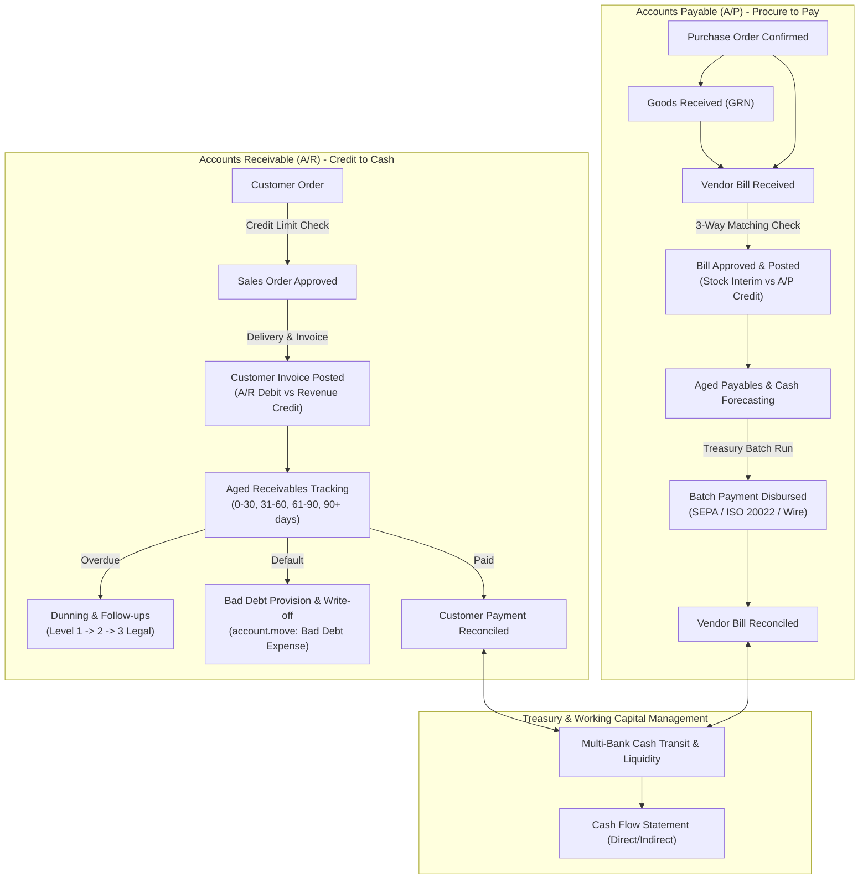

# Corporate Finance, Accounts Receivable (A/R) & Accounts Payable (A/P) End-to-End Flow

```
╔══════════════════════════════════════════════════════════════════════════════╗
║  CORPORATE FINANCE, A/R & A/P BUSINESS PROCESS LIFECYCLE                     ║
║  Working Capital, Credit Management, 3-Way Matching, Treasury & Bad Debt     ║
║  Standard Odoo Functional Enterprise Architecture & Internal Controls (SoD)  ║
╚══════════════════════════════════════════════════════════════════════════════╝
```

## 1. High-Level Corporate Financial Architecture

In enterprise operations, **Corporate Finance** coordinates the working capital engine of the company: controlling customer credit exposure, enforcing strict procurement disbursement verifications, managing multi-bank liquidity, and ensuring month-end ledger accuracy.



---

## 2. Accounts Receivable (A/R) Corporate Operations

### Phase 1: Credit Limits, Risk Profiling & Order Blocking

Enterprises protect cash flow by establishing credit governance before orders are accepted:

1. **Customer Credit Limit (`res.partner`)**:
   - Setting **Total Receivable Limit** on customer master.
   - **Warning / Blocking Policy**:
     - *Warning*: Salesperson receives alert but can proceed with manager sign-off.
     - *Hard Block*: System prevents sales order confirmation if `Total Open Invoices + Uninvoiced Sales Orders > Credit Limit`.
2. **Payment Terms & Cash Discounts**:
   - Complex payment structures configured via `account.payment.term`:
     - **30 Days End of Month (30 EOM)**.
     - **Cash Discount (Early Settlement)**: Example `2/10 Net 30` (2% cash discount if paid within 10 days, full payment due in 30 days).
     - **Milestone Split Terms**: 30% Down Payment, 40% on Delivery, 30% at Net 60 days.

---

### Phase 2: Aged Receivables & Dunning Collection (`account_followup`)

When invoices cross their contractual due dates, corporate collections execute automated dunning levels:

```
┌─────────────────────────────────────────────────────────────────────────────┐
│                       AGED RECEIVABLES & DUNNING MATRIX                     │
├─────────────┬──────────────┬────────────────────────────┬───────────────────┤
│ Aging Bucket│ Days Past Due│ Automated Action           │ Tone / Mechanism  │
├─────────────┼──────────────┼────────────────────────────┼───────────────────┤
│ Current     │ 0 Days       │ Standard Invoice Delivery  │ Transactional     │
│ Bucket 1    │ 1 - 15 Days  │ Reminder Level 1 (Email)   │ Gentle / Friendly │
│ Bucket 2    │ 16 - 30 Days │ Reminder Level 2 (Call Log)│ Formal Notice     │
│ Bucket 3    │ 31 - 60 Days │ Demand Level 3 (Letter)    │ Warning / Restrict│
│ Bucket 4    │ 60+ Days     │ Legal / Collection Agency  │ Legal Action      │
└─────────────┴──────────────┴────────────────────────────┴───────────────────┘
```

#### Automated Dunning Levels (`account_followup`)
- **Action**: Odoo auto-evaluates overdue statements, logs follow-up history in customer chatter, and generates batched reminder emails with secure payment links.
- **Exclusion**: Specific disputed invoice lines can be placed on **Hold / In Dispute** to prevent erroneous customer harassment.

---

### Phase 3: Bad Debt Provision & Write-Off

When receivables become permanently uncollectible:

1. **Allowance for Doubtful Accounts (Provisioning)**:
   - At month-end, finance reserves a percentage of aged debt:
     - **Debit**: Bad Debt Expense `605000` (P&L)
     - **Credit**: Allowance for Doubtful Accounts `110900` (Contra-Asset)
2. **Direct Write-Off (`account.move.line` Reconciliation)**:
   - When confirmed bankrupt or legally unrecoverable:
     - **Debit**: Allowance for Doubtful Accounts `110900` (or Bad Debt Expense)
     - **Credit**: Accounts Receivable `110000` (Customer Account)
   - The invoice status transitions from **Open** to **Reconciled / Written Off**.

---

## 3. Accounts Payable (A/P) Corporate Operations

### Phase 1: Internal Controls & 3-Way Matching

Corporate A/P enforces strict segregation of duties (SoD) to prevent embezzlement, duplicate billing, and payment for damaged goods:

```
                  ┌───────────────────────────────┐
                  │    PO: Purchase Order         │ (Approved Price & Qty)
                  └───────────────┬───────────────┘
                                  │
         ┌────────────────────────┴────────────────────────┐
         ▼                                                 ▼
┌───────────────────────────────┐         ┌───────────────────────────────┐
│    GRN: Goods Receipt Note    │         │    BILL: Vendor Tax Invoice   │
│  (Physical Verified Quantity) │         │  (Billed Unit Price & Tax ID) │
└───────────────┬───────────────┘         └───────────────┬───────────────┘
                │                                         │
                └─────────────────┬───────────────────────┘
                                  ▼
                 ┌─────────────────────────────────┐
                 │    3-WAY MATCHING AUDIT ENGINE  │
                 ├─────────────────────────────────┤
                 │ 1. Qty Received >= Qty Billed?  │
                 │ 2. Unit Price PO == Unit Price? │
                 │ 3. Tax / VAT Calculation Valid? │
                 └─────────────────────────────────┘
```

#### Handling 3-Way Matching Exceptions
- **Price Variance**: If vendor bill price exceeds PO price beyond tolerance (e.g. > 1%), bill is locked in **Exception State** requiring Buyer and Procurement Director authorization.
- **Quantity Variance**: If vendor bills 100 units but warehouse only received 80 units, Odoo holds the bill or auto-creates a partial bill for 80 units, pending remainder delivery.

---

### Phase 2: Vendor Prepayments & Advance Down Payments

For high-value capital equipment or specialized subcontracting:

1. **Advance Payment Registration**:
   - Procurement pays supplier deposit before production:
     - **Debit**: Advance Payments to Suppliers `114000` (Asset)
     - **Credit**: Bank Account `101000`
2. **Clearing Advance on Final Bill**:
   - Final vendor bill arrives for full contract value:
     - **Debit**: Expense / Asset Account `150000`
     - **Credit**: Accounts Payable `201000`
   - Finance reconciles the Advance Payment line against the Accounts Payable line, leaving only the remaining balance due for disbursement.

---

### Phase 3: Maker-Checker Payment Authorizations & Batch Disbursement

1. **Maker-Checker Workflow**:
   - **AP Clerk (Maker)**: Reviews bills, matches supporting documents, drafts payment batch.
   - **AP Supervisor (Checker)**: Verifies bank account numbers against vendor master record.
   - **Finance Director / CFO (Approver)**: Digital token sign-off authorizing cash release.
2. **Corporate Batch Payments (`account.batch.payment`)**:
   - Bundles hundreds of validated vendor bills into a unified electronic payment:
     - **SEPA Credit Transfer (ISO 20022 XML)** for European banking.
     - **Corporate ACH / Wire CSV format** for US/Global banking.
   - Uploaded directly to corporate banking portal or dispatched via direct Host-to-Host (H2H) sFTP integration.

---

## 4. Treasury, Cash Management & Liquidity

### Bank Clearing & Internal Cash Transfers

Enterprises avoid direct transfers between balance sheet bank accounts to maintain clean reconciliation audit trails:

```
[ Primary Operating Account ] ──> [ Bank Transit Clearing Account ] ──> [ Payroll Account ]
       (Debit / Credit)                      (101200 Transit)                  (Debit / Credit)
```

1. **Internal Transfer Initiation**:
   - Transfer \$100,000 from Operating Account to Payroll Account:
     - **Leg 1**: Debit Bank Transit `101200`, Credit Operating Bank `101010`.
     - **Leg 2**: Debit Payroll Bank `101020`, Credit Bank Transit `101200`.
   - Result: Transit account zeroes out; each physical bank statement reconciles cleanly against its own leg.

### Petty Cash Imprest System

1. Fixed float established (e.g., \$2,000 petty cash drawer).
2. Minor operational expenses incurred (office supplies, courier, emergency fuel).
3. Custodian submits receipts periodically:
   - System reimburses exact amount spent to restore float back to \$2,000.

---

## 5. Month-End Corporate Financial Closing Checklist

```
┌─────────────────────────────────────────────────────────────────────────────┐
│                 CORPORATE MONTH-END FINANCIAL CLOSE CHECKLIST               │
├─────┬──────────────────────────┬────────────────────────────────────────────┤
│ Day │ Domain                   │ Action Performed in Odoo                   │
├─────┼──────────────────────────┼────────────────────────────────────────────┤
│ D-1 │ Inventory Cut-off        │ Validate all pending pickings & receipts;  │
│     │                          │ check for negative stock quants.           │
│ D+1 │ Sales Cut-off            │ Invoice all fulfilled delivery orders;     │
│     │                          │ review unbilled shipments (COGS accrued).  │
│ D+2 │ Purchasing Cut-off       │ Verify 3-Way Match exceptions; post all    │
│     │                          │ validated vendor bills.                    │
│ D+3 │ Bank Reconciliation      │ Complete 100% clearing of all electronic   │
│     │                          │ bank statement feeds across all journals.  │
│ D+4 │ Accruals & Deferrals     │ Run automated Depreciation Board for Fixed │
│     │                          │ Assets; amortize Prepayments/Deferred Rev. │
│ D+5 │ FX Revaluation           │ Execute month-end Unrealized FX provision  │
│     │                          │ on foreign currency A/R and A/P balances.  │
│ D+6 │ Tax Return Reconciliation│ Audit Output VAT vs Input VAT grids; lock  │
│     │                          │ Tax Lock Date.                             │
│ D+7 │ Final Lock & Financials  │ Apply 'All Users Lock Date'; generate Group│
│     │                          │ Balance Sheet, P&L, and Cash Flow report.  │
└─────┴──────────────────────────┴────────────────────────────────────────────┘
```

---

## 6. Version-Specific Differences (v14 – v20)

| Area | Odoo 14 – 15 | Odoo 16 – 17 | Odoo 18 – 20 |
|---|---|---|---|
| **Cash Discounts (`2/10 Net 30`)** | Complex manual tax write-off entries required. | Native **Cash Discount** configuration in Payment Terms with auto-repartition. | Instant cash discount proposal in bank reconciliation tool. |
| **Credit Limit Enforcement** | Third-party module or custom code required. | Native **Customer Credit Limits** in core settings (Warning / Block). | Real-time automated credit limit check across parent companies and child subsidiaries. |
| **Vendor Bill Digitization (OCR)**| Manual credit-based OCR service. | Built-in side-by-side PDF viewer with automated vendor bank extraction. | Automated matching against Purchase Orders with zero-click bill posting. |
| **Bank Transit Accounts** | Single default transit account shared across company. | Dedicated incoming and outgoing payment transit accounts per bank journal. | Automated transit clearing models with AI-driven bank charge write-offs. |
