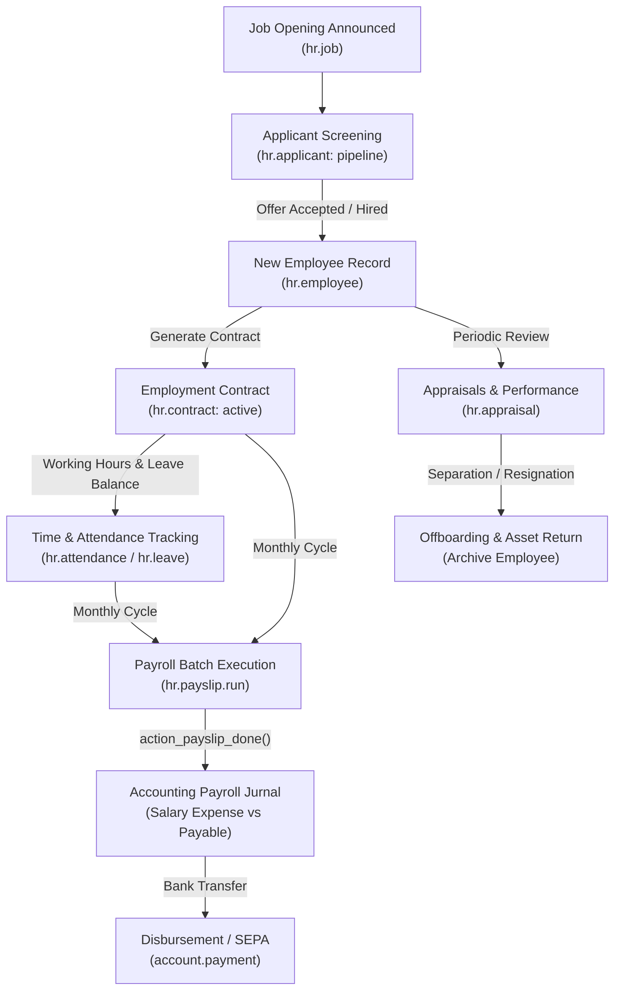

# Hire-to-Retire (H2R / HR) End-to-End Business Flow

```
╔══════════════════════════════════════════════════════════════════════════════╗
║  HIRE-TO-RETIRE (H2R) BUSINESS PROCESS LIFECYCLE                             ║
║  From Talent Acquisition & Onboarding to Payroll, Time Off & Offboarding     ║
║  Standard Odoo Functional Process Map & HR Operations Integration            ║
╚══════════════════════════════════════════════════════════════════════════════╝
```

## 1. High-Level Process Architecture

The **Hire-to-Retire (H2R)** cycle covers the entire employee lifecycle within an enterprise, connecting **Recruitment**, **Employee Directory**, **Work Contracts**, **Attendances & Leaves**, **Payroll & Compensation**, and **Performance Appraisals**.



---

## 2. Stage-by-Stage Functional Breakdown

### Phase 1: Talent Acquisition & Recruitment (`hr_recruitment`)

1. **Job Position (`hr.job`)**:
   - Defines target positions, expected hires count, job description, department, and recruitment manager.
2. **Applicant Pipeline (`hr.applicant`)**:
   - Applications collected via online careers page, email alias, or job boards.
   - Candidate stages: `Initial Qualification` ➔ `First Interview` ➔ `Technical Test` ➔ `Contract Proposal` ➔ `Contract Signed`.
3. **Candidate Hiring (`create_employee_from_applicant`)**:
   - Clicking **Create Employee** transfers candidate contact information, resume attachments, and position into an active employee record.

---

### Phase 2: Onboarding & Contract Setup (`hr_contract`)

1. **Employee Record (`hr.employee`)**:
   - Private information (Address, SSN/ID, Bank Account, Emergency Contacts).
   - Work information (Department, Manager, Coach, Work Location, Working Schedule).
2. **Employment Contract (`hr.contract`)**:
   - Defines start date, wage/salary, salary structure type, schedule (`resource.calendar`), and fringe benefits.
   - Status: `draft` ➔ `open` (Running) ➔ `close` (Expired).

---

### Phase 3: Time Off & Attendance Management (`hr_holidays` & `hr_attendance`)

1. **Attendance Tracking**:
   - Kiosk mode (PIN or Barcode badge scan), RFID cards, mobile geolocation app, or web attendance.
2. **Leave Allocations (`hr.leave.allocation`)**:
   - **Regular Allocation**: Granted manually or in batch by company/department.
   - **Accrual Plans**: Earned automatically (e.g., +1.5 days accrued per month worked).
3. **Time Off Request & Approval (`hr.leave`)**:
   - Employee requests leave ➔ Manager approves ➔ HR Officer validates.
   - Calendar automatically blocks employee availability and adjusts planned project timesheets.

---

### Phase 4: Payroll Execution & Salary Rules (`hr_payroll`)

1. **Batch Payslip Generation (`hr.payslip.run`)**:
   - Monthly batch creates payslips for all active employees with running contracts.
2. **Salary Computation Engine**:
   - Computes salary rules sequentially based on Python formulas:
     - **Basic Salary (`BASIC`)**: Base contract wage pro-rated for unpaid leaves.
     - **Allowances (`ALW`)**: Housing, Transport, Meal allowances.
     - **Gross Salary (`GROSS`)**: Basic + Allowances.
     - **Deductions (`DED`)**: Income Tax (PAYE/PPh), Employee Social Security / Insurance.
     - **Net Salary (`NET`)**: Gross - Deductions.
3. **Payroll Accounting Integration**:
   - Validating the payslip batch posts journal entries into the General Ledger:
     - **Debit**: Salaries Expense Account `601000`
     - **Debit**: Employer Social Security Expense `601100`
     - **Credit**: Tax Withholding Payable `212000`
     - **Credit**: Social Security Payable `213000`
     - **Credit**: Salaries Payable (Net Wages) `211000`
4. **Disbursement**:
   - Generates SEPA / Bank CSV payment file to release funds to employee bank accounts.

---

### Phase 5: Appraisals, Career Progression & Offboarding

1. **Performance Appraisals (`hr.appraisal`)**:
   - 360-degree reviews between employee, manager, and peers.
   - Goal setting, KPI scoring, and salary review recommendations.
2. **Offboarding & Separation**:
   - Resignation or termination notice logged.
   - Exit checklist executed: Return company assets (laptop, access badge, vehicle), revoke system access, and generate final severance payslip.
   - Employee archived (`active = False`).

---

## 3. Version-Specific Differences (v14 – v20)

| Area | Odoo 14 – 15 | Odoo 16 – 17 | Odoo 18 – 20 |
|---|---|---|---|
| **Leave Accrual Plans** | Basic allocation grant schedules. | **Accrual Plans (`hr.leave.accrual.plan`)**: Milestones, carryover rules, pro-rating. | Negative balance threshold controls & optional holiday configs. |
| **User & Access Architecture**| Groups assigned via `groups_id`. | Enhanced private address & contract encryption. | **`group_ids` architecture**: Clean assignment replacing legacy field. |
| **Appraisals & Reviews** | Annual formal evaluation forms. | Continuous 360-degree feedback with peer evaluations. | Skill progression matrix linked directly to promotion tracks. |
| **Attendance & Geolocation** | Standard web / kiosk sign in. | Geofencing validation on mobile app check-ins. | Touchless biometric / RFID badge reader hardware integration. |

