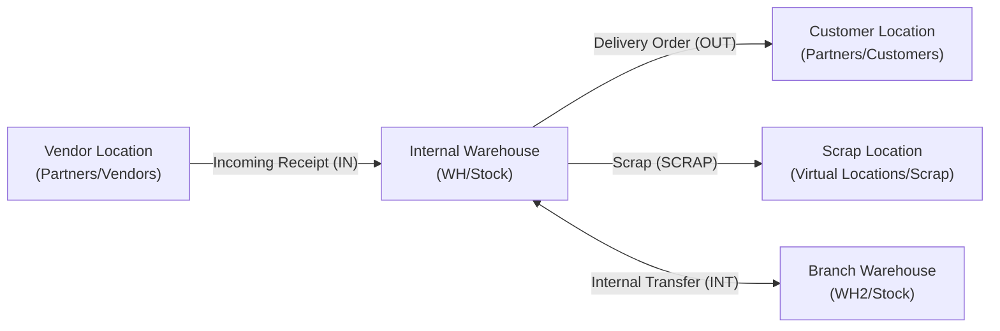

# Inventory, Valuation & Logistics End-to-End Business Flow

```
╔══════════════════════════════════════════════════════════════════════════════╗
║  INVENTORY, VALUATION & LOGISTICS BUSINESS PROCESS LIFECYCLE                 ║
║  Warehouse Routing, Costing Methods, Perpetual Accounting & Landed Costs     ║
║  Standard Odoo Functional Process Map & Inter-Module Automation              ║
╚══════════════════════════════════════════════════════════════════════════════╝
```

## 1. High-Level Process Architecture

Inventory in Odoo is modeled as a **Double-Entry Bookkeeping System**: products do not appear or disappear—they move between physical, virtual, and partner locations.



---

## 2. Warehouse Locations & Routing Architecture

### Location Types in Odoo

| Location Category | Type | Purpose | Example |
|---|---|---|---|
| **Internal Location** | Physical | Physical warehouse zones owned by company. Counts toward total asset valuation. | `WH/Stock`, `WH/Stock/Shelf A` |
| **Vendor Location** | Virtual/Partner | Source counterpart location for incoming supplier shipments. | `Partner Locations/Vendors` |
| **Customer Location** | Virtual/Partner | Destination counterpart location for outgoing deliveries. | `Partner Locations/Customers` |
| **Inventory Loss** | Virtual | Balancing counterpart for physical stock adjustment discrepancies. | `Virtual Locations/Inventory adjustment` |
| **Production** | Virtual | Balancing counterpart for raw material consumption and finished goods generation. | `Virtual Locations/Production` |
| **Transit Location** | Internal/Inter-company | Holds goods currently in transit between distinct warehouses or legal entities. | `Inter-Company Transit` |

---

## 3. Product Costing Methods & Inventory Valuation

Configured on **Product Category (`product.category`)**:

### Costing Methods (`property_cost_method`)

1. **Standard Price (`standard`)**:
   - Manually defined fixed cost on the product template.
   - Cost does not change automatically upon receiving supplier bills with different purchase prices.
   - Variances between PO price and standard cost are booked into a **Price Difference Account**.
2. **Average Cost / AVCO (`average`)**:
   - Moving weighted average calculated dynamically on every incoming receipt:
     $$\text{New Cost} = \frac{(\text{Current Qty} \times \text{Current Cost}) + (\text{Incoming Qty} \times \text{Incoming Unit Price})}{\text{Current Qty} + \text{Incoming Qty}}$$
3. **First-In, First-Out / FIFO (`fifo`)**:
   - Tracks individual valuation layers (`stock.valuation.layer`).
   - Outgoing shipments consume the oldest available inventory batch at its exact historical purchase cost.

---

### Inventory Valuation Modes (`property_valuation`)

```
┌─────────────────────────────────────────────────────────────────────────────┐
│                          INVENTORY VALUATION MODES                          │
├──────────────────────────────────────────┬──────────────────────────────────┤
│ Periodic / Manual                        │ Perpetual / Automated            │
├──────────────────────────────────────────┼──────────────────────────────────┤
│ • No automated journal entries created   │ • Every single stock movement    │
│   during receipts or deliveries.         │   creates balanced GL entries.   │
│ • Inventory balance updated manually     │ • Real-time balance sheet        │
│   at month-end or year-end via           │   accuracy for current assets.   │
│   adjusting journal entries (Opname).    │ • Requires Interim accounts for  │
│ • Standard for simple accounting.        │   goods in transit.              │
└──────────────────────────────────────────┴──────────────────────────────────┘
```

#### Journal Entries Generated Under Perpetual / Automated Valuation

```
1. Inbound Receipt (WH/IN):
   Debit:  Inventory Valuation Account   $1,000  (Asset Increases)
   Credit: Stock Interim (Received)      $1,000  (Liability / Accrual)

2. Vendor Bill Confirmation (BILL):
   Debit:  Stock Interim (Received)      $1,000  (Clears Transit Accrual)
   Credit: Accounts Payable              $1,000  (Vendor Debt)

3. Outbound Delivery (WH/OUT):
   Debit:  Cost of Goods Sold (COGS)     $600    (Expense)
   Credit: Inventory Valuation Account   $600    (Asset Decreases)

4. Customer Invoice Confirmation (INV):
   Debit:  Accounts Receivable           $1,000  (Customer Debt)
   Credit: Sales Revenue                 $1,000  (Income)
```

---

## 4. Landed Costs (`stock.landed.cost`)

When importing goods, purchase price is only part of total cost. Freight, customs duties, port charges, and insurance must be capitalized into product valuation:

1. **Create Landed Cost Record**:
   - Reference one or more validated Incoming Receipts (`stock.picking`).
2. **Add Cost Lines**:
   - Example: Ocean Freight \$1,500, Customs Import Duty \$800.
3. **Split Method**:
   - **By Quantity**: Distributed equally per unit.
   - **By Current Cost**: Distributed proportional to purchase value.
   - **By Weight / Volume**: Distributed based on physical cargo properties.
4. **Validation (`button_validate`)**:
   - Generates an additional `stock.valuation.layer` per product line.
   - Automatically posts GL journal entry:
     - **Debit**: Inventory Valuation Account
     - **Credit**: Freight / Landed Cost Interim Expense Account

---

## 5. Physical Inventory & Stock Adjustments (`stock.quant`)

To reconcile physical warehouse reality with system records:

1. Navigate to **Inventory ‣ Operations ‣ Physical Inventory**.
2. Filter by Location or Product Category.
3. Operators input **Counted Quantity** vs current **On Hand Quantity**.
4. Click **Apply**:
   - Updates physical stock quantity immediately.
   - In Automated Valuation, posts journal entry for the difference:
     - If Surplus: **Debit** Inventory Valuation, **Credit** Inventory Loss / Gain.
     - If Deficit / Theft: **Debit** Inventory Loss / Shrinkage, **Credit** Inventory Valuation.

---

## 6. Advanced Logistics Strategies

- **Cross-Docking**: Bypasses storage racks; incoming goods from supplier receipts are routed directly to outgoing delivery staging bays.
- **Dropshipping**: Purchase Order directs supplier to ship directly to customer partner address without physical receipt in company warehouses.
- **Removal Strategies (Putaway & Picking)**:
  - **FIFO**: Picks oldest lot first.
  - **LIFO**: Picks newest lot first (rarely used in accounting).
  - **FEFO (First Expiry, First Out)**: Enforces picking products with earliest expiration dates (essential for food, beverages, and chemicals).

---

## 7. Version-Specific Differences (v14 – v20)

| Area | Odoo 14 – 15 | Odoo 16 – 17 | Odoo 18 – 20 |
|---|---|---|---|
| **Stock Opname (Physical Count)** | Standalone inventory adjustment wizard. | Continuous inventory count directly on `stock.quant` list view. | Real-time cycle counting with mobile barcode scanning and auto-apply. |
| **Package & Wave Picking** | Basic package hierarchy. | Automated batch picking by delivery zone or carrier. | Wave picking and cluster picking native in Barcode app. |
| **Landed Cost Allocation** | Manually created record attached to picking receipts. | Landed costs directly linkable to supplier bills. | Dynamic allocation across multi-warehouse transfers and dropship orders. |
| **Removal Strategies** | Defined strictly at Product Category or Location level. | Removal strategy rules expanded with flexible storage categories. | Storage category weight & volume limit enforcement on putaway. |

