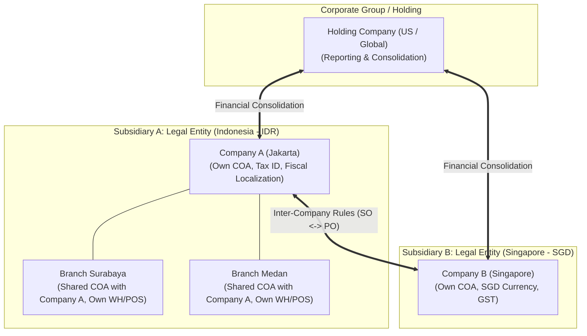
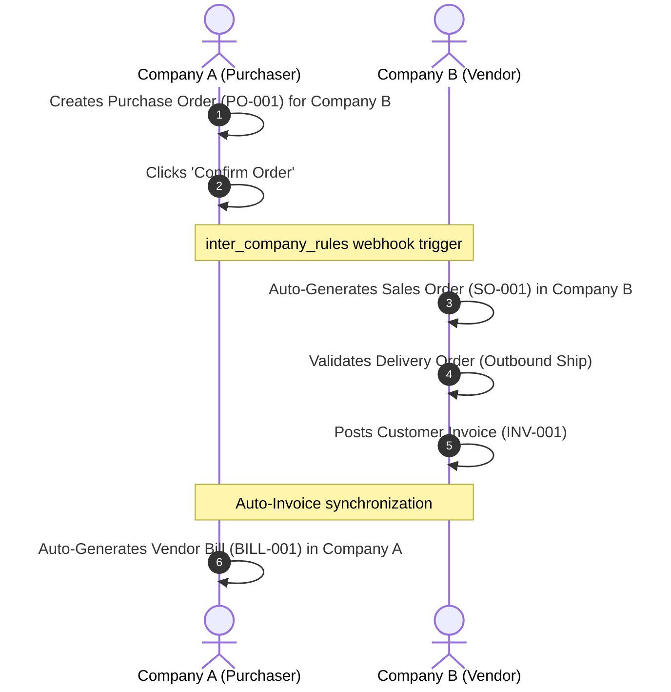

# Multi-Company, Branches & Inter-Company Transactions End-to-End Flow

```
╔══════════════════════════════════════════════════════════════════════════════╗
║  MULTI-COMPANY, BRANCHES & INTER-COMPANY BUSINESS PROCESS LIFECYCLE          ║
║  Subsidiaries vs Branches, Inter-Company SO/PO Sync, Transit & Consolidation ║
║  Standard Odoo Functional Process Map & Multi-Entity Enterprise Architecture ║
╚══════════════════════════════════════════════════════════════════════════════╝
```

## 1. High-Level Multi-Entity Architecture

In modern Odoo enterprise deployments, a single database can host complex corporate hierarchies, ranging from **legally independent subsidiaries** operating in different countries to **operational branch offices** sharing a unified balance sheet.



---

## 2. Subsidiaries vs Branches (The Fundamental Distinction)

Configured under **Settings ‣ Companies**:

| Characteristic | Legal Subsidiaries (Separate Entities) | Branches (Operational Subdivisions - v17+) |
|---|---|---|
| **Legal Status** | Distinct legal corporations with separate Tax IDs. | Units of a single legal entity (shops, regional offices). |
| **Chart of Accounts (COA)** | **Isolated**: Each company has its own COA and fiscal localization. | **Shared**: Automatically inherits the Parent Company's COA. |
| **Main Currency** | Can differ (e.g., Company A uses `IDR`, Company B uses `SGD`). | **Identical**: Must use Parent Company's primary currency. |
| **Fiscal Periods & Lock Dates**| Independent closing dates and tax lock dates per entity. | Shared fiscal periods; branches can set earlier lock dates if needed. |
| **Inter-Entity Transfers** | Requires commercial transactions: **Inter-Company SO ➔ PO**. | Physical **Internal Transfers** (`stock.picking: INT`) between warehouses. |
| **Financial Reporting** | Combined via **Group Financial Consolidation**. | Instantly aggregated into Parent Company reports without elimination. |

---

## 3. Master Data Sharing & Isolation Policies

In a multi-company environment, records are categorized as **Shared (Global)** or **Company-Specific (Isolated)**:

```
┌─────────────────────────────────────────────────────────────────────────────┐
│                     DATA SHARING & ISOLATION MATRIX                         │
├──────────────────────────┬──────────────────────────┬───────────────────────┤
│ Model                    │ Field Value              │ Functional Behavior   │
├──────────────────────────┼──────────────────────────┼───────────────────────┤
│ Product (product.template)│ company_id = False       │ Shared across all     │
│                          │                          │ subsidiaries/branches.│
│ Product (product.template)│ company_id = Company A   │ Visible ONLY to       │
│                          │                          │ Company A users.      │
│ Customer / Partner       │ company_id = False       │ Global contact address│
│ (res.partner)            │                          │ book. Receivable/     │
│                          │                          │ Payable accounts are  │
│                          │                          │ tracked per company.  │
│ Warehouse & Location     │ company_id = Mandatory  │ Strictly isolated per │
│ (stock.warehouse)        │                          │ company entity.       │
│ Chart of Accounts        │ company_id = Mandatory  │ Isolated per legal    │
│ (account.account)        │ (or Parent for Branches) │ entity localization.  │
│ Journal Entries          │ company_id = Mandatory  │ Strictly isolated to  │
│ (account.move)           │                          │ the issuing company.  │
└──────────────────────────┴──────────────────────────┴───────────────────────┘
```

---

## 4. Automated Inter-Company Transactions (`inter_company_rules`)

When legally distinct subsidiaries trade goods or services with one another, Odoo automates reciprocal document creation:



### Configuration Modes (`res.config.settings` ‣ Inter-Company Transactions)
- **Synchronize Sales Order and Purchase Order**:
  - `SO ➔ PO` or `PO ➔ SO` synchronization.
  - Option to create linked documents in `Draft` (requiring manual review) or automatically `Confirmed`.
- **Synchronize Invoices and Bills**:
  - Validating a Customer Invoice in Company B automatically generates a draft or posted Vendor Bill in Company A.
- **Automatic Currency Conversion**:
  - If Company A uses `USD` and Company B uses `EUR`, prices convert dynamically based on daily rates in `res.currency.rate`.

---

## 5. Multi-Company Inventory & Physical Transit

Physical movement of stock between different legal entities requires distinct logistics controls:

1. **Inter-Company Transit Location**:
   - Outbound delivery from Company A ships to virtual transit location: `Physical Locations/Inter-Company Transit`.
   - Inbound receipt in Company B pulls goods from `Inter-Company Transit` into Company B's warehouse stock.
   - **Financial Ownership**: While in transit, goods are legally owned by either vendor or purchaser depending on agreed **Incoterms** (e.g. FOB vs CIF).
2. **Branch Transfers (Same Legal Entity - v17+)**:
   - Stock transferred directly via **Internal Transfer** (`stock.picking: internal`) between warehouses:
     - Source: `Jakarta/Stock`
     - Destination: `Surabaya/Stock`
   - No commercial sale or purchase order needed; inventory value remains on the company's single consolidated balance sheet.

---

## 6. Financial Consolidation & Reporting

### Multi-Company Selector (Native View)
Users with permissions across multiple companies use the top navbar company switcher:
- **Active Company (`env.company`)**: The primary entity under which new transactions are authored.
- **Allowed Companies (`env.companies`)**: Checked entities whose financial data is consolidated into dynamic reports.

### Group Financial Consolidation (`account_consolidation`)
For corporate holding groups managing subsidiaries with different currencies and charts of accounts:
1. **Consolidated Chart of Accounts**:
   - Maps divergent subsidiary local accounts to uniform Group Reporting Accounts (e.g., mapping Indonesian Account `111000 Kas Bank` and Singapore Account `1001 Cash at Bank` to Group Account `1000 Cash Equivalents`).
2. **Historical vs Closing Currency Conversion**:
   - Assets & Liabilities converted at period **Closing Rate**.
   - P&L Income & Expenses converted at period **Average Rate**.
   - Equity converted at **Historical Rate**.
3. **Inter-Company Elimination Entries**:
   - Automatically eliminates reciprocal inter-company revenue/expense and inter-company receivables/payables so group profits are not artificially inflated.

---

## 7. Version-Specific Differences (v14 – v20)

| Area | Odoo 14 – 15 | Odoo 16 | Odoo 17 – 18 | Odoo 19 – 20 |
|---|---|---|---|---|
| **Branch Hierarchy** | No official branch concept. Cabang had to be configured as full separate companies with manual COA duplication. | Workarounds using analytic accounts or multi-warehouse tags. | **Native Branches Introduced**: Child companies sharing parent's COA, currency, and tax packages. | Native branch filtering on POS terminals and branch-level invoice sequences. |
| **Inter-Company Rules** | Configured in `res.company` partner form. | Unified settings in General Settings per company. | Automated inter-company delivery status tracking between SO and PO. | Instant real-time two-way confirmation and automated payment offset. |
| **Security Context** | `company_ids` evaluated via global `ir.rule`. | `allowed_company_ids` context variable standardized. | Fast multi-company domain caching in ORM. | **`ir.access` clean evaluation**: Record rules leverage `company_ids` without performance degradation. |
| **Company Switcher UI** | Basic dropdown selector with full page reload. | Multi-checkbox selector without page reloads. | Fast asynchronous session switching. | Touch-optimized company switch widget with visual branch badges. |

