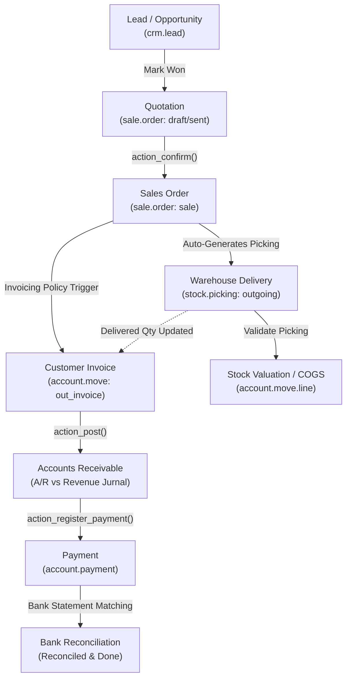

# Order-to-Cash (O2C) End-to-End Business Flow

```
╔══════════════════════════════════════════════════════════════════════════════╗
║  ORDER-TO-CASH (O2C) BUSINESS PROCESS LIFECYCLE                              ║
║  From Lead Acquisition to Bank Reconciliation & Financial Ledger             ║
║  Standard Odoo Functional Process Map & Inter-Module Automation              ║
╚══════════════════════════════════════════════════════════════════════════════╝
```

## 1. High-Level Process Architecture

The **Order-to-Cash (O2C)** cycle represents the primary revenue-generating pipeline in Odoo ERP, seamlessly connecting **CRM**, **Sales**, **Inventory**, **E-Commerce**, **Invoicing**, and **General Ledger Accounting**.



---

## 2. Stage-by-Stage Functional Breakdown

### Phase 1: Lead to Sales Order (CRM & Sales)

1. **Lead Qualification (`crm.lead`)**:
   - Inbound inquiries arrive via website contact forms, emails, or manual entry.
   - Converted into Opportunities with estimated revenue, probability, and target expected closing date.
   - Stages: `New` ➔ `Qualified` ➔ `Proposition` ➔ `Won`.
2. **Quotation Creation (`sale.order`)**:
   - Clicking **New Quotation** from the opportunity pre-populates customer data, payment terms, and price list.
   - Products added with quantities, unit prices, discounts, and applicable taxes.
   - Status: `draft` (Quotation).
3. **Quotation Sent**:
   - Sent via email (PDF report attached) to the customer.
   - Online signature/portal payment enabled (`sale.order` status: `sent`).
4. **Order Confirmation (`action_confirm`)**:
   - Triggered upon customer signature, online payment, or manual click on **Confirm**.
   - **Status Transition**: Moves from `sent` ➔ `sale` (Sales Order).
   - **System Automation**:
     - Locks quotation pricing.
     - Automatically creates one or more delivery orders (`stock.picking`) in Inventory if products are storable (`type == 'consu'` / `'product'`).
     - Schedules analytic account tracking if Analytic Accounting is configured.

---

### Phase 2: Warehouse Fulfillment & Logistics (Inventory)

The delivery flow depends on the warehouse route configuration set in **Inventory ‣ Configuration ‣ Warehouses**:

| Route Model | Steps | Picking Types Generated | Business Use Case |
|---|---|---|---|
| **1-Step Delivery** | Direct delivery | `Delivery Order` (`OUT`) | Small business, simple pick and pack together. |
| **2-Step Delivery** | Pick + Ship | `Pick` (`PICK`) ➔ `Delivery Order` (`OUT`) | Moderate warehouse with staging bay before shipping. |
| **3-Step Delivery** | Pick + Pack + Ship | `Pick` (`PICK`) ➔ `Pack` (`PACK`) ➔ `Ship` (`OUT`) | Large enterprise, dedicated packing & palletizing zone. |

#### Stock Availability & Reservation
- **Check Availability**: Odoo verifies available physical stock vs virtual stock (`free_qty = qty_available - reserved_qty`).
- **Reserved Stock**: Components allocated exclusively to this order.
- **Partial Delivery & Backorders**:
  - If only partial quantity is available or picked, validating the transfer prompts:
    - **Create Backorder**: Generates a secondary `stock.picking` for the remaining items.
    - **No Backorder**: Cancels remaining unfulfilled quantities.

---

### Phase 3: Invoicing Policy & Revenue Recognition

Odoo determines **when** and **how much** a customer can be invoiced based on the **Invoicing Policy** defined on each Product:

```
┌─────────────────────────────────────────────────────────────────────────────┐
│                       PRODUCT INVOICING POLICY                              │
├──────────────────────────────────────────┬──────────────────────────────────┤
│ Ordered Quantities                       │ Delivered Quantities             │
│ (Pre-payment / Standard Services)        │ (Physical Goods / Post-Delivery) │
├──────────────────────────────────────────┼──────────────────────────────────┤
│ • Invoice can be created immediately     │ • Invoice can ONLY be created    │
│   after Sales Order is confirmed.        │   after Delivery Order is Done.  │
│ • qty_to_invoice = product_uom_qty       │ • qty_to_invoice = qty_delivered │
│ • Use for: Subscriptions, Custom Orders, │ • Use for: Wholesale, Retail,    │
│   Services with advance retainer.        │   Perishable or weighed goods.   │
└──────────────────────────────────────────┴──────────────────────────────────┘
```

#### Creating the Customer Invoice (`account.move`)
1. In the Sales Order, click **Create Invoice**:
   - **Regular Invoice**: Invoices all fulfilled / eligible quantities.
   - **Down Payment (Percentage)**: Generates advance invoice (e.g. 30% DP).
   - **Down Payment (Fixed Amount)**: Generates flat advance invoice.
2. The draft invoice is generated with lines referencing `sale_line_id`.
3. Validating the Invoice (`action_post`):
   - Generates sequential invoice numbering (e.g. `INV/2026/00042`).
   - Creates balanced accounting journal entries:
     - **Debit**: Accounts Receivable (A/R) `110000` (Customer Debt)
     - **Credit**: Sales Revenue `400000` (Income)
     - **Credit**: Tax Payable (VAT Output) `220000`

---

### Phase 4: Customer Payment & Bank Reconciliation

1. **Register Payment (`account.payment`)**:
   - Customer pays via Bank Transfer, Cash, Credit Card, or Virtual Account.
   - Click **Register Payment** on the invoice:
     - **Debit**: Bank / Cash Transit Account `101200`
     - **Credit**: Accounts Receivable `110000`
   - Invoice status moves to **In Payment**.
2. **Bank Statement Import & Reconciliation**:
   - Electronic bank statement imported (OFX, MT940, CSV) or synchronized via Bank Synchronization.
   - Reconciling the statement line against the payment transit account:
     - **Debit**: Bank Account `101000`
     - **Credit**: Bank / Cash Transit Account `101200`
   - Invoice status moves to **Paid**.

---

### Phase 5: Returns, Refunds & Credit Notes

When a customer returns goods:
1. **Return Picking (`stock.return.picking`)**:
   - Open the completed Delivery Order ➔ Click **Return**.
   - Validating the return increments warehouse stock and updates `qty_delivered` on the Sales Order.
2. **Credit Note (`account.move: out_refund`)**:
   - Open Customer Invoice ➔ Click **Credit Note**.
   - Select reason (Full Refund, Partial Refund, or Cancel).
   - Reverses the accounting entry (Credits A/R, Debits Revenue and VAT).
3. **Refund Payment / Offset**:
   - Either payout funds back to customer or leave as open credit balance offset against future invoices.

---

## 3. Key Accounting Jurnals Impact Matrix (Automated Valuation)

When **Automated Inventory Valuation (Perpetual)** is enabled on the Product Category:

| Event | Document | Accounting Debit | Accounting Credit |
|---|---|---|---|
| **Delivery Done** | `stock.picking` (OUT) | **Cost of Goods Sold (COGS)** | **Stock Interim (Delivered)** |
| **Invoice Posted** | `account.move` (INV) | **Accounts Receivable (A/R)** | **Sales Revenue** & **Tax Payable** |
| **Invoice Reconciliation**| `account.move` | **Stock Interim (Delivered)** | **Inventory Valuation Account** *(Clears Interim)* |
| **Payment Registered** | `account.payment` | **Bank Transit Account** | **Accounts Receivable (A/R)** |
| **Bank Statement Reconciled**| `account.bank.statement` | **Main Bank Account** | **Bank Transit Account** |

---

## 4. Role Responsibility & Approval Matrix

| Role | Permitted Actions | Critical Responsibilities |
|---|---|---|
| **Salesperson** | Create Lead, Create Quotation, Send by Email | Accurate customer info, delivery address, discount limits. |
| **Sales Manager** | Approve quotations above threshold, Confirm SO | Review margins, authorize payment terms & custom discounts. |
| **Warehouse Operator** | Reserve stock, Print Pick List, Validate Picking | Ensure physical items match serial/lots, record damaged goods. |
| **Billing / Accountant** | Create Invoice, Post Invoice, Register Payment | Match quantities with delivery slip, verify tax rates. |
| **Treasury / Finance** | Reconcile Bank Statements | Ensure all cash inflows are accounted for and cleared. |

---

## 5. Version-Specific Differences (v14 – v20)

| Area | Odoo 14 – 15 | Odoo 16 – 17 | Odoo 18 – 20 |
|---|---|---|---|
| **Down Payment Invoicing** | Dedicated wizard creating flat down payment lines. | Down payments integrated with tax grid repartition. | Automated down payment deduction during regular invoice creation with strict draft validation. |
| **Analytic Distribution** | `analytic_account_id` set per sale order line. | Replaced by `analytic_distribution` (JSON multi-plan distribution). | Automated distribution tags matching customer dimension. |
| **Online Payment & Portal** | Redirect to external gateway page. | Inline modal checkout with saved tokens. | One-click express checkout (Apple Pay, Google Pay) directly from quotation link. |
| **Delivery Validation** | Standard validate button. | Barcode app batch validation with carrier label auto-print. | Real-time packing verification and IoT scale weight recording. |

