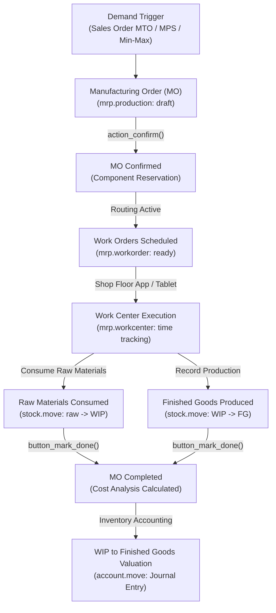

# Plan-to-Produce (P2P / MRP) End-to-End Business Flow

```
╔══════════════════════════════════════════════════════════════════════════════╗
║  PLAN-TO-PRODUCE (MRP) BUSINESS PROCESS LIFECYCLE                            ║
║  From Demand Planning to Shop Floor Execution & Finished Goods Costing       ║
║  Standard Odoo Functional Process Map & Inter-Module Automation              ║
╚══════════════════════════════════════════════════════════════════════════════╝
```

## 1. High-Level Process Architecture

The **Plan-to-Produce** cycle covers industrial manufacturing, demand forecasting, bill of materials (BOM) management, work center capacity, shop-floor time tracking, and inventory transformation from raw materials to finished goods.



---

## 2. Stage-by-Stage Functional Breakdown

### Phase 1: Demand Sources & Production Planning

Manufacturing Orders are triggered by three primary demand sources:

1. **Make-to-Order (MTO / Replenish on Order)**:
   - A Sales Order confirmation automatically creates a linked Manufacturing Order if the product has the **Manufacture** and **MTO** routes enabled.
2. **Master Production Schedule (MPS)**:
   - Mid-to-long term production plan based on sales forecasts and target safety stock.
   - Computes planned MO launches week-by-week.
3. **Reordering Rules (Min-Max)**:
   - When finished goods drop below safety threshold, the scheduler launches an MO for batch replenishment.

---

### Phase 2: Bill of Materials (BOM) & Routing Design

The Bill of Materials (`mrp.bom`) defines the recipe and labor required:

```
┌─────────────────────────────────────────────────────────────────────────────┐
│                           BILL OF MATERIALS (BOM)                           │
├─────────────────────────────────────────────────────────────────────────────┤
│ Finished Product: Executive Desk [DESK001]                                  │
│ Quantity: 1 Units                                                           │
│ BOM Type: Manufacture this product (vs Kit / Phantom vs Subcontracting)     │
├────────────────────────────┬─────────────────────────────┬──────────────────┤
│ Components (Raw Materials) │ Quantity                    │ Consumed In      │
│ • Wood Panel (OAK)         │ 4.0 m2                      │ Operation 10     │
│ • Steel Legs               │ 4.0 Units                   │ Operation 20     │
│ • Screws & Fasteners       │ 24.0 Units                  │ Operation 20     │
├────────────────────────────┼─────────────────────────────┼──────────────────┤
│ Operations (Routing)       │ Work Center                 │ Duration         │
│ • Op 10: Wood Cutting      │ Cutting CNC Work Center     │ 30 mins          │
│ • Op 20: Frame Assembly    │ Assembly Station 1          │ 45 mins          │
│ • Op 30: Quality & Polish  │ Finishing & QA Center       │ 15 mins          │
└────────────────────────────┴─────────────────────────────┴──────────────────┘
```

#### BOM Types in Odoo
- **Manufacture this product**: Standard production creating work orders and consuming components.
- **Kit (Phantom BOM)**: Not manufactured in the shop floor; automatically splits into individual components upon Sales Delivery (e.g. Gift Hamper, Computer Bundle).
- **Subcontracting**: Components supplied to external subcontractor who manufactures and returns the finished product.

---

### Phase 3: Manufacturing Order Lifecycle & Reservation

1. **Draft Order (`draft`)**:
   - Product, quantity, scheduled start date, and BOM selected.
2. **Order Confirmation (`action_confirm`)**:
   - Status transitions to `confirmed`.
   - **Component Reservation**: Odoo checks raw material availability in warehouse (`stock.quant`).
   - If stock is sufficient: Status changes to `assigned` (Ready to Produce).
   - If stock is missing: Automatically generates replenishment RFQs / POs via procurement rules.

---

### Phase 4: Shop Floor Execution & Work Orders

If work orders are enabled, operators interact via the tablet-friendly **Shop Floor App**:

1. **Scheduling Work Centers (`mrp.workcenter`)**:
   - Each work center has working capacity, efficiency %, and cost per hour.
   - Operations scheduled sequentially based on routing precedence.
2. **Work Order Operations (`mrp.workorder`)**:
   - **Start**: Operator clicks start; real-time stopwatch records labor duration.
   - **Pause / Block**: Operator pauses or logs maintenance downtime.
   - **Done**: Operator records completed units, quality check pass/fail, and component lots/serials consumed.
3. **By-Products & Scrap**:
   - **By-Products**: Additional products harvested during the run (e.g. Wood Sawdust generated during Cutting).
   - **Scrap (`stock.scrap`)**: Defective parts rejected and moved to virtual scrap location.

---

### Phase 5: Production Completion & Cost Analysis

1. **Mark as Done (`button_mark_done`)**:
   - Consumes reserved raw materials from stock.
   - Generates physical stock for finished goods with specific Lot/Serial numbers (`stock.lot`).
   - Updates MO status to `done`.
2. **Cost Structure Analysis**:
   Odoo calculates the true manufacturing unit cost:
   $$\text{Total Cost} = \sum \text{Raw Material Costs} + \sum (\text{Labor Duration} \times \text{Work Center Hourly Rate})$$

---

## 3. Inventory & Accounting Jurnals Impact Matrix (Automated Valuation)

When **Automated Inventory Valuation (Perpetual)** is active:

| Phase | Operational Action | Accounting Debit | Accounting Credit |
|---|---|---|---|
| **Raw Material Consumption** | Components consumed in MO | **Work in Process (WIP)** | **Raw Materials Inventory** |
| **Work Center Labor / Overhead** | Operation time recorded | **Work in Process (WIP)** | **Labor / Overhead Absorption Account** |
| **Finished Goods Receipt** | Finished units entered stock | **Finished Goods Inventory** | **Work in Process (WIP)** *(Clears WIP)* |
| **Scrap Recorded** | Defective part scrapped | **Scrap Expense Account** | **Raw Materials Inventory** |

---

## 4. Unbuild Orders & Disassembly (`mrp.unbuild`)

When returning or salvaging products:
- An **Unbuild Order** reverses the BOM:
  - Consumes finished goods inventory.
  - Returns original raw material components back into available warehouse stock.
  - Reverses inventory valuation entries according to original unit cost.

---

## 5. Version-Specific Differences (v14 – v20)

| Area | Odoo 14 – 15 | Odoo 16 – 17 | Odoo 18 – 20 |
|---|---|---|---|
| **Shop Floor Operations** | Standard backend form views or barcode app. | **Shop Floor App (`mrp_workorder`)**: Touchscreen tablet interface for operators. | Direct interactive assembly guides (PDF/Slides) with stopwatch pause/resume. |
| **Work Center Maintenance** | Maintenance requests logged in separate app. | Maintenance requests triggerable directly from work order screen. | Workcenter blocking directly from Shop Floor tablet halting planned production. |
| **BOM Engineering (ECO)** | Manual BOM duplication or basic PLM. | Engineering Change Orders (ECO) with visual diff comparisons. | Multi-tier engineering sign-off with automated revision archiving. |
| **Subcontracting Portal** | Manual picking validation for subcontractor. | Dedicated subcontractor portal for inventory receipt logging. | Automated component drop-ship tracking to subcontractor premises. |

