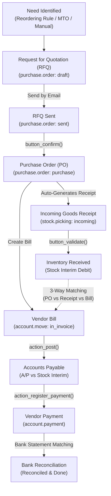

# Procure-to-Pay (P2P) End-to-End Business Flow

```
╔══════════════════════════════════════════════════════════════════════════════╗
║  PROCURE-TO-PAY (P2P) BUSINESS PROCESS LIFECYCLE                             ║
║  From Procurement Requisition to 3-Way Matching & Vendor Payment            ║
║  Standard Odoo Functional Process Map & Inter-Module Automation              ║
╚══════════════════════════════════════════════════════════════════════════════╝
```

## 1. High-Level Process Architecture

The **Procure-to-Pay (P2P)** cycle manages an enterprise's inbound supply chain, connecting **Inventory Replenishment**, **Purchasing**, **Quality Control**, **Vendor Bill Processing**, **3-Way Matching**, and **Accounts Payable**.



---

## 2. Stage-by-Stage Functional Breakdown

### Phase 1: Procurement Need Identification

In Odoo, replenishment needs originate from three primary operational drivers:

1. **Automated Reordering Rules (`stock.warehouse.orderpoint`)**:
   - Evaluated periodically by the scheduler (`ir.cron` Procurement Scheduler).
   - If `Forecasted Quantity < Minimum Quantity`, Odoo creates an RFQ for `Maximum Quantity - Forecasted Quantity`.
2. **Make to Order (MTO / Replenish on Order)**:
   - When a confirmed Sales Order requires products marked with the **MTO** route, a linked Purchase Order is created instantly.
3. **Manual Purchase Requisition (`purchase.requisition`)**:
   - Employees or department heads submit Purchase Agreements (Blanket Orders or Purchase Tenders) requiring competitive bids from multiple vendors.

---

### Phase 2: RFQ & Purchase Order Confirmation

1. **Request for Quotation (`purchase.order` status: `draft`)**:
   - Contains supplier details, currency, payment terms, order lines, and target scheduled receipt date.
   - Price calculation respects vendor pricelists (`product.supplierinfo`) with minimum quantities and tiered lead times.
2. **RFQ Sent (`sent`)**:
   - Dispatched to vendor via email with attached RFQ PDF.
   - Quotation prices and delivery lead times updated upon supplier response.
3. **Purchase Order Confirmation (`button_confirm`)**:
   - Status transitions from `sent` ➔ `purchase`.
   - **System Automation**:
     - Locks agreed purchase price.
     - Automatically generates an **Incoming Shipment** (`stock.picking`, receipt type) in the warehouse.

---

### Phase 3: Warehouse Goods Receipt (1-Step, 2-Step, 3-Step)

The inbound warehouse route configured in **Inventory ‣ Warehouses** determines physical handling:

| Route Model | Steps | Operational Stages | Use Case |
|---|---|---|---|
| **1-Step Receipt** | Direct to Stock | `Receipt` (`IN`) ➔ `Stock` | Standard retail, office supplies, non-critical items. |
| **2-Step Receipt** | Input ➔ Stock | `Input` (`IN`) ➔ `Internal Transfer` (`INT`) | Bulk unloading and staging before shelving. |
| **3-Step Receipt** | Input ➔ QC ➔ Stock | `Input` (`IN`) ➔ `Quality Check` ➔ `Stock` (`INT`) | Manufacturing raw materials, pharmaceuticals, food safety. |

#### Receipt Inspection & Backorders
- **Full Receipt**: If quantities received match ordered quantities, validating marks `stock.picking` as **Done**.
- **Partial Receipt**: If supplier delivers less than ordered:
  - **Create Backorder**: Generates an open sub-receipt for the remaining balance.
  - **No Backorder**: Closes the PO receiving balance.
- **Scrap / Quality Failure**: Damaged goods are diverted directly to virtual scrap location (`stock.scrap`) without entering usable inventory.

---

### Phase 4: 3-Way Matching (PO vs Receipt vs Vendor Bill)

Odoo Enterprise enforces **3-Way Matching** to prevent overpaying suppliers or paying for undelivered goods:

```
        ┌────────────────────────────────────────────────────────┐
        │                 3-WAY MATCHING AUDIT                   │
        ├──────────────────────────┬─────────────────────────────┤
        │ Purchase Order           │ Ordered: 100 units @ $10    │
        │ Goods Receipt (Picking)  │ Received: 80 units          │
        │ Vendor Bill              │ Billed: 100 units @ $10     │
        ├──────────────────────────┴─────────────────────────────┤
        │ STATUS: [ EXCEPTION ] Billed quantity exceeds received │
        │ ACTION: Hold bill payment until remaining 20 units are │
        │         received OR request a revised vendor bill.     │
        └────────────────────────────────────────────────────────┘
```

#### Control Policies (`purchase_method`) on Products
- **On Ordered Quantities**: Bill can be created immediately upon PO confirmation (typical for services, subscriptions, software licenses).
- **On Received Quantities**: Bill can ONLY be created for quantities that have been physically validated as received in the warehouse (`qty_received`).

---

### Phase 5: Vendor Bill & Accounts Payable Posting

1. **Vendor Bill Creation (`account.move: in_invoice`)**:
   - Auto-generated from PO lines by clicking **Create Bill**.
   - Inherits vendor reference, invoice date, accounting date, and payment terms.
2. **Posting the Bill (`action_post`)**:
   - **Status Transition**: Moves from `draft` ➔ `posted`.
   - **Accounting Jurnals Generated (Automated Inventory Valuation)**:
     - **Debit**: Stock Interim Account (Received) `101300` (Clears goods received transit)
     - **Debit**: Tax Receivable (VAT Input) `115000`
     - **Credit**: Accounts Payable (A/P) `201000` (Company Debt to Vendor)

---

### Phase 6: Vendor Payment & Bank Clearing

1. **Register Payment (`account.payment`)**:
   - Click **Register Payment** on the Vendor Bill:
     - Method: Manual, SEPA Credit Transfer, Check, or Wire.
     - **Debit**: Accounts Payable (A/P) `201000`
     - **Credit**: Bank Transit Account `101200`
   - Bill status changes to **In Payment**.
2. **Batch Payments**:
   - Purchasing/Treasury bundles multiple vendor bills into a single **Batch Payment** to generate bank payment files (e.g. ISO 20022 XML).
3. **Bank Statement Reconciliation**:
   - Upon importing the actual bank statement debit:
     - **Debit**: Bank Transit Account `101200`
     - **Credit**: Main Bank Account `101000`
   - Bill status completes as **Paid**.

---

### Phase 7: Vendor Returns & Debit Notes

1. **Return to Vendor (`stock.return.picking`)**:
   - From the completed receipt, click **Return** to generate an outgoing vendor return picking.
   - Decreases physical stock.
2. **Vendor Refund / Debit Note (`account.move: in_refund`)**:
   - Click **Credit Note** on the Vendor Bill.
   - Offsets existing accounts payable or generates a refund transit balance.

---

## 3. Key Accounting Jurnals Impact Matrix (Automated Valuation)

| Event | Document | Accounting Debit | Accounting Credit |
|---|---|---|---|
| **Goods Receipt Done** | `stock.picking` (IN) | **Inventory Valuation Account** | **Stock Interim (Received)** |
| **Vendor Bill Posted** | `account.move` (BILL) | **Stock Interim (Received)** & **VAT Input** | **Accounts Payable (A/P)** |
| **Payment Registered** | `account.payment` | **Accounts Payable (A/P)** | **Bank Transit Account** |
| **Bank Statement Reconciled**| `account.bank.statement` | **Bank Transit Account** | **Main Bank Account** |

---

## 4. Role Responsibility & Segregation of Duties (SoD)

| Role | Permitted Actions | SoD Safeguard |
|---|---|---|
| **Procurement Buyer** | Create RFQ, Negotiate, Confirm PO | Cannot validate goods receipts or approve vendor bills. |
| **Warehouse Receiver** | Inspect goods, Validate `stock.picking` | Cannot modify PO purchase prices or vendor bank info. |
| **Accounts Payable Clerk**| Create & Match Vendor Bill (3-Way Match) | Cannot authorize bank payment disbursements. |
| **Finance Controller / CFO**| Authorize Payment Batches, Post Outflow | Requires 3-Way Match sign-off before releasing cash. |

---

## 5. Version-Specific Differences (v14 – v20)

| Area | Odoo 14 – 15 | Odoo 16 – 17 | Odoo 18 – 20 |
|---|---|---|---|
| **3-Way Matching** | Basic visual indicator or manual comparison. | Automated 3-way match exception banner on bill lines. | Automated matching with vendor PDF/XML auto-upload (OCR). |
| **Vendor Bill Digitization** | Standalone OCR credit service. | Native PDF side-by-side view with automated field extraction. | Automated vendor bank account IBAN verification via vendor bills. |
| **Purchase Agreements** | Rigid tender vs blanket order forms. | Dynamic purchase agreement types with flexible price matrices. | Automated supplier portal bidding and award notifications. |
| **Receipt Backorders** | Standard pop-up wizard. | Barcode app split transfer handling. | Touch-screen bin location assignment during receipt validation. |

