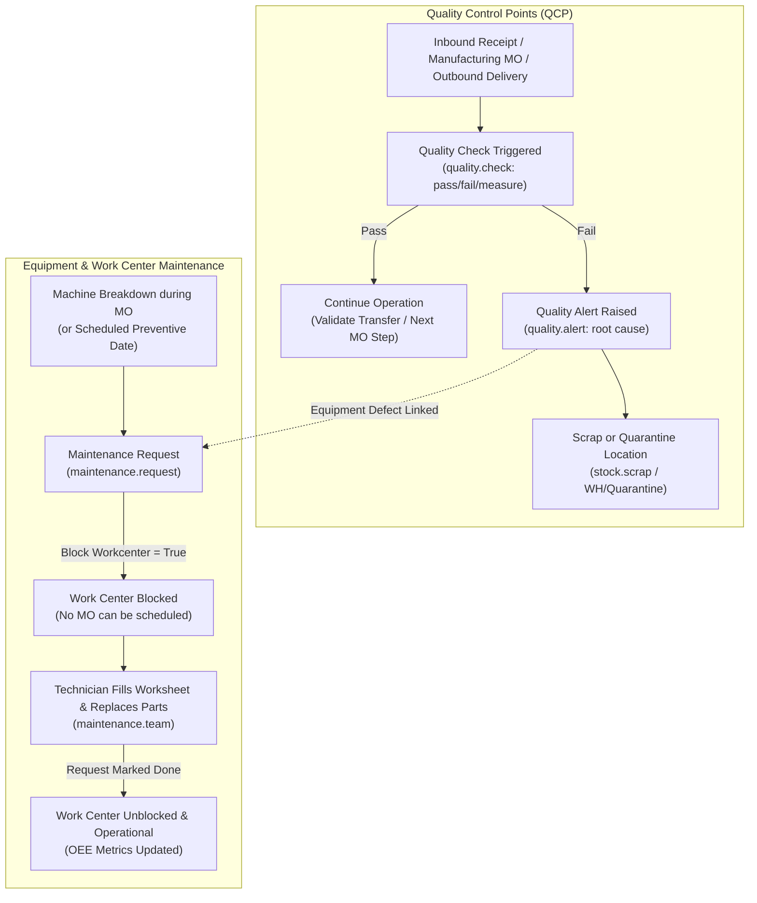

# Quality Assurance & Asset Maintenance End-to-End Business Flow

```
╔══════════════════════════════════════════════════════════════════════════════╗
║  QUALITY ASSURANCE & ASSET MAINTENANCE BUSINESS PROCESS LIFECYCLE            ║
║  Quality Control Points, Work Center Maintenance & Equipment Reliability     ║
║  Standard Odoo Functional Process Map & Inter-Module Automation              ║
╚══════════════════════════════════════════════════════════════════════════════╝
```

## 1. High-Level Process Architecture

This operational cycle connects **Quality Assurance (`quality_control`)** across inventory receipts and shop floor manufacturing with **Asset Maintenance (`maintenance`)** for machines, tools, and work centers.



---

## 2. Quality Control Management (`quality_control`)

### Phase 1: Quality Control Points (QCP) Configuration

Configured under **Quality ‣ Quality Control ‣ Control Points**:

1. **Triggering Operations**:
   - **Receipts (`IN`)**: Inspect supplier goods at warehouse arrival.
   - **Manufacturing Work Orders (`mrp.workorder`)**: Inspect in-process assemblies at designated work centers.
   - **Delivery Orders (`OUT`)**: Final audit before loading onto customer freight.
2. **Inspection Type (`test_type`)**:
   - **Pass / Fail**: Operator visually confirms criteria and clicks Pass or Fail.
   - **Measure**: Operator records numerical value (e.g. thickness in mm, resistance in ohms). Validated against min/max tolerance thresholds.
   - **Take a Picture**: Operator must capture and upload a live photo of the batch label or physical component.
   - **Instructions / Worksheet**: Operator fills structured multi-step checklist.
3. **Control Frequency**:
   - **All Operations**: Checks every receipt or MO line.
   - **Randomly (# % of the time)**: Statistical sample inspection (e.g. 10% of shipments).
   - **Periodically**: Checked once every X days/weeks.
   - **On-Demand**: Manually initiated by quality auditor.

---

### Phase 2: Inspection Execution & Quality Alerts

1. **Executing the Quality Check (`quality.check`)**:
   - Integrated directly into the warehouse barcode interface or Shop Floor tablet view.
   - A red banner locks the transfer or work order until the check is formally completed.
2. **Quality Alerts & Defect Containment (`quality.alert`)**:
   - When a test fails:
     - Quality team tags Root Cause (Component defect, Machine miscalibration, Operator error).
     - Failed goods transferred to **Quarantine** or **Scrap Location** (`stock.scrap`).
     - Corrective and Preventive Action (CAPA) logged in chatter.

---

## 3. Equipment & Asset Maintenance (`maintenance`)

### Phase 1: Equipment Registry (`maintenance.equipment`)

Tracks machines, CNC routers, tools, testing benches, and fleet vehicles:
- **Category**: Machinery, Computer Hardware, Transport.
- **Linked Work Center**: Assigns equipment to specific production work centers (`mrp.workcenter`).
- **Maintenance Metrics**:
  - **MTBF (Mean Time Between Failures)**: Average operational hours before equipment breaks.
  - **MTTR (Mean Time To Repair)**: Average duration to restore broken equipment to operational state.

---

### Phase 2: Preventive vs Corrective Maintenance (`maintenance.request`)

```
┌─────────────────────────────────────────────────────────────────────────────┐
│                       MAINTENANCE REQUEST MODES                             │
├──────────────────────────────────────────┬──────────────────────────────────┤
│ Preventive Maintenance                   │ Corrective Maintenance           │
├──────────────────────────────────────────┼──────────────────────────────────┤
│ • Proactive, calendar-based scheduling   │ • Reactive, triggered by sudden  │
│   (e.g., Oil change every 90 days).      │   breakdowns or quality failures.│
│ • Generated automatically by system cron │ • Initiated immediately by shop  │
│   based on frequency rules.              │   floor operator from tablet.    │
│ • Scheduled during non-peak factory      │ • Flagged as High/Urgent ⭐⭐⭐; │
│   hours to prevent disruptions.          │   blocks work center instantly.  │
└──────────────────────────────────────────┴──────────────────────────────────┘
```

#### Work Center Blocking (`block_workcenter = True`)
- When a machine breaks down, the technician checks **Block Workcenter**.
- **Odoo Protection**: The production scheduler immediately halts all active work orders at that station, preventing resource conflicts and recalculating manufacturing delivery deadlines.

---

### Phase 3: Repair Execution & Unblocking

1. **Technician Workflow**:
   - Assigned maintenance team logs into **Maintenance ‣ Maintenance Requests**.
   - Review instructions (PDF guide or Google Slides SOP attached to request).
   - Fill out **Custom Maintenance Worksheet** detailing replaced spare parts and calibration readings.
2. **Completion**:
   - Technician marks request as **Repaired / Done**.
   - Work Center unblocked automatically.
   - Overall Equipment Effectiveness (OEE) and downtime statistics updated in manufacturing analytics.

---

## 4. Version-Specific Differences (v14 – v20)

| Area | Odoo 14 – 15 | Odoo 16 – 17 | Odoo 18 – 20 |
|---|---|---|---|
| **Shop Floor Quality Checks** | Checks triggered in backend work order view. | Direct interactive quality pass/fail banner on Shop Floor tablet. | Barcode camera scan integration for instant batch certificate capture. |
| **Maintenance Worksheets** | Standard text notes. | Customizable interactive worksheet templates for technicians. | Step-by-step mobile checklist with mandatory photo upload before unblocking. |
| **Work Center Blocking** | Manual communication to production planner. | Automatic work order rescheduling when work center is blocked. | Real-time visual maintenance alert banner on all connected operator terminals. |
| **Statistical Quality Control**| Basic pass/fail percentage reports. | Tolerance deviation graphs and automated root-cause categorization. | Predictive failure alerts based on sensor IoT input and maintenance logs. |

