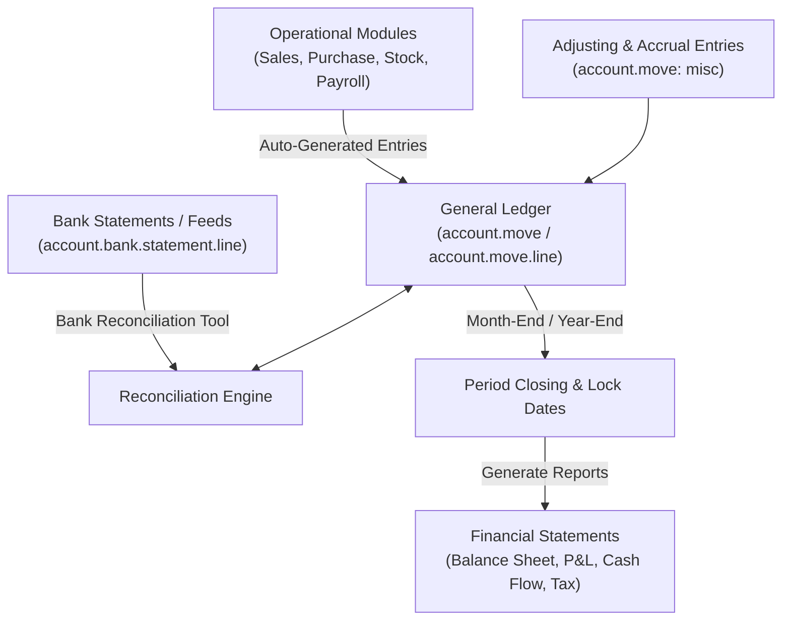

# Record-to-Report (R2R) End-to-End Business Flow

```
╔══════════════════════════════════════════════════════════════════════════════╗
║  RECORD-TO-REPORT (R2R) BUSINESS PROCESS LIFECYCLE                           ║
║  From General Ledger & Multi-Currency to Reconciliation & Period Close       ║
║  Standard Odoo Functional Process Map & Financial Reporting Architecture     ║
╚══════════════════════════════════════════════════════════════════════════════╝
```

## 1. High-Level Process Architecture

The **Record-to-Report (R2R)** cycle consolidates financial data across all enterprise operations, providing compliance, audit trails, and financial statements (Balance Sheet, Profit & Loss, Cash Flow).



---

## 2. Chart of Accounts (COA) & Journal Architecture

### Account Types Hierarchy (`account.account`)

| Account Type Category | Account Types | Normal Balance | Financial Statement |
|---|---|---|---|
| **Balance Sheet: Assets** | Bank and Cash, Receivables, Current Assets, Non-current Assets, Prepayments | Debit | Balance Sheet |
| **Balance Sheet: Liabilities** | Payables, Credit Card, Current Liabilities, Non-current Liabilities | Credit | Balance Sheet |
| **Balance Sheet: Equity** | Equity, Retained Earnings | Credit | Balance Sheet |
| **P&L: Income** | Operating Income, Other Income | Credit | Profit and Loss |
| **P&L: Expense** | Cost of Revenue (COGS), Operating Expenses, Depreciation | Debit | Profit and Loss |

### Journals (`account.journal`)
All financial entries flow through dedicated journals:
- **Customer Invoices (`sale`)**: Invoices and credit notes to customers.
- **Vendor Bills (`purchase`)**: Supplier bills and debit notes.
- **Bank (`bank`)**: Bank account statement lines and payment clearing.
- **Cash (`cash`)**: Physical petty cash and register drawers.
- **Miscellaneous (`general`)**: Adjusting entries, asset depreciation, payroll, opening balances.

---

## 3. Bank Statement Reconciliation Engine

Odoo features an intelligent, multi-layer matching engine:

```
┌─────────────────────────────────────────────────────────────────────────────┐
│                       BANK RECONCILIATION ENGINE                            │
├─────────────────────────────────────────────────────────────────────────────┤
│ Bank Statement Line: +$5,400 from ACME Corp (Ref: INV/2026/0012)            │
├─────────────────────────────────────────────────────────────────────────────┤
│ 1. Exact Match: Finds open invoice INV/2026/0012 for $5,400                 │
│ 2. Partner Matching: Auto-detects customer 'ACME Corp'                      │
│ 3. Cash Discount Model: Auto-applies 2% early payment discount if qualified │
│ 4. Write-off / Bank Fees: Auto-creates expense line for wire transaction fee│
└─────────────────────────────────────────────────────────────────────────────┘
```

#### Reconciliation Models (`account.reconcile.model`)
- **Rule: Match Existing Invoices/Bills**: Auto-matches payment lines against open receivables/payables based on reference or partner.
- **Rule: Write-off / Bank Fees**: Creates instant balancing lines (e.g., \$15 bank fee expense).
- **Rule: Match Against Cash Basis**: Tracks cash-basis tax liability when payment is validated.

---

## 4. Multi-Currency & Foreign Exchange (FX)

When transacting in multiple currencies:

1. **Transaction Entry**: Recorded in foreign currency (e.g., EUR €1,000) and converted to company currency (e.g., USD \$1,080) at the daily exchange rate (`res.currency.rate`).
2. **Realized FX Gain/Loss**:
   - Invoice issued at 1 EUR = \$1.08 (\$1,080 A/R).
   - Customer pays when 1 EUR = \$1.10 (\$1,100 received in bank).
   - Odoo automatically posts:
     - **Credit**: Realized Foreign Exchange Gain \$20.
3. **Unrealized FX Revaluation (Month-End)**:
   - Evaluates all open foreign currency balances at month-end closing rate.
   - Books unrealized gain/loss provisions, auto-reversed on the 1st of the next month.

---

## 5. Accruals, Deferrals & Asset Depreciation

### Deferred Revenues & Expenses
- **Deferred Expense (Prepayments)**: Example: Annual insurance \$12,000 paid upfront in January. Amortized automatically as \$1,000/month expense across 12 months.
- **Deferred Revenue (Unearned Income)**: Customer pays for an annual SaaS subscription in advance; revenue recognized monthly as service is delivered.

### Fixed Assets Management (`account.asset`)
- Tracks purchase of capital assets (Equipment, Buildings, Vehicles).
- Generates automated straight-line or declining balance depreciation schedules.
- Monthly depreciation entries:
  - **Debit**: Depreciation Expense
  - **Credit**: Accumulated Depreciation

---

## 6. Period Closing & Audit Compliance

To prevent retroactive tampering and maintain audit compliance:

```
┌─────────────────────────────────────────────────────────────────────────────┐
│                          ACCOUNTING LOCK DATES                              │
├─────────────────────────────────────────────────────────────────────────────┤
│ Journal Items Lock Date (All Users):                                        │
│ • No user (including CFO/Admins) can modify or post entries prior to date.  │
│                                                                             │
│ Journal Items Lock Date (Non-Advisers):                                     │
│ • Regular billing and sales staff locked; only Chief Accountant can edit.   │
│                                                                             │
│ Tax Return Lock Date:                                                       │
│ • Prevents modifications to transactions included in validated VAT returns. │
└─────────────────────────────────────────────────────────────────────────────┘
```

### Year-End Closing
Odoo uses a **Dynamic General Ledger**:
- No destructive "Closing Entries" needed to zero out P&L accounts.
- Balance Sheet accounts carry forward balances.
- P&L accounts dynamically compute Current Year Earnings into the Equity section.

---

## 7. Financial Statements & Reporting

| Report | Description | Key Stakeholders |
|---|---|---|
| **Balance Sheet** | Snapshot of Financial Position: Assets = Liabilities + Equity at specific date. | Investors, Banks, Board |
| **Profit & Loss (P&L)** | Financial Performance: Gross Margin, Operating Expenses, Net Income over period. | Management, Tax Authorities |
| **Cash Flow Statement** | Cash Movements: Operating, Investing, and Financing activities. | Treasury, Executives |
| **Aged Receivables / Payables** | Aging buckets (0-30, 30-60, 60-90, 90+ days) for credit management. | Credit Controllers |
| **Tax Audit Report / VAT Return** | Breakdown of base amounts and output/input tax per legal tax grid. | Tax Auditors |

---

## 8. Version-Specific Differences (v14 – v20)

| Area | Odoo 14 – 15 | Odoo 16 – 17 | Odoo 18 – 20 |
|---|---|---|---|
| **Bank Reconciliation UI** | Legacy JS widget (`account.reconciliation.widget`). | **Completely rewritten**: Form view on statement lines with auto-matching tabs. | Instant batch reconciliation powered by automated rule models. |
| **Analytic Accounting** | Single `analytic_account_id` per line or analytic tags. | **Analytic Plans (`analytic.plan`)**: Multi-dimensional JSON distribution (`analytic_distribution`). | Mandatory analytic plans enforced by account category. |
| **Electronic Invoicing (EDI)**| Country-specific modules. | Native European Peppol / UBL Factur-X integration. | Global Peppol network directory automated send/receive by default. |
| **Financial Reporting** | Static reports or basic dynamic drill-down. | Fast dynamic spreadsheet drill-down reports. | Real-time multi-company consolidation with dynamic elimination entries. |

