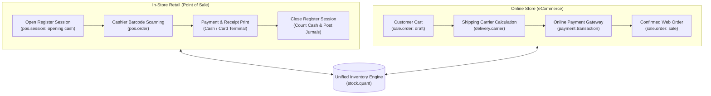

# Retail & Omnichannel (POS & eCommerce) End-to-End Business Flow

```
╔══════════════════════════════════════════════════════════════════════════════╗
║  RETAIL & OMNICHANNEL (POS + E-COMMERCE) BUSINESS PROCESS LIFECYCLE          ║
║  Point of Sale Sessions, Web Checkout, Carrier Rates, and Cash Clearing      ║
║  Standard Odoo Functional Process Map & Unified Commerce Architecture        ║
╚══════════════════════════════════════════════════════════════════════════════╝
```

## 1. High-Level Process Architecture

The **Retail & Omnichannel** flow unifies brick-and-mortar storefronts (**Point of Sale / POS**) with digital storefronts (**eCommerce / Website Sale**), sharing a synchronized customer base, unified price lists, and real-time multi-location inventory.



---

## 2. In-Store Point of Sale (POS) Lifecycle

### Phase 1: Session Opening & Float Control

1. **Open Session (`pos.session`)**:
   - Cashier logs into specific POS terminal.
   - Cashier enters **Opening Cash Float** (counted starting bills and coins in register drawer).
   - Session status: `opening_control` ➔ `opened`.

---

### Phase 2: Cashier Operations & Fast Checkout

1. **Order Processing (`pos.order`)**:
   - Barcode scanning (USB/Bluetooth scanner) or visual touchscreen catalog.
   - Price calculation respects customer-specific pricelists and tax inclusion rules (B2C Tax Included vs B2B Tax Excluded).
   - Real-time customer identification (loyalty points accrual, customer credit balance).
2. **Payment Collection**:
   - **Split Payments**: Customer can pay partially with Cash and balance via Credit Card.
   - **IoT Electronic Payment Terminal**: Integrated card terminals (Ingenico, Stripe, Adyen) automatically process transactions without manual cashier amount input.
3. **Mid-Session Cash Control (Cash In / Cash Out)**:
   - **Put Money In**: Additional change added from back-office safe.
   - **Take Money Out**: Mid-day cash drop to safe for security, or petty cash expense (e.g. buying store cleaning supplies).

---

### Phase 3: Session Closing & Cash Reconciliation

1. **Closing Register (`close_session`)**:
   - Cashier counts actual physical bills and coins in the drawer.
   - Odoo compares **Counted Cash** vs **Expected Cash** (Starting Float + Cash Sales + Cash In - Cash Out).
   - Any difference is classified as **Cash Difference** (Gain or Shortage).
2. **Posting Financial Entries**:
   - Closing the session automatically aggregates orders and posts balancing journal entries:
     - **Debit**: Cash Clearing / Card Receivable Accounts
     - **Credit**: POS Revenue & Output Tax Accounts
     - **Debit/Credit**: Cash Difference Gain/Loss Account (if drawer was over or short)
   - Decrements warehouse stock via consolidated stock picking transfers.

---

## 3. Online eCommerce & Web Checkout Lifecycle

1. **Cart Lifecycle (`website_sale`)**:
   - Online visitor adds products to cart (`sale.order` in `draft` with `website_id`).
   - Price calculation dynamically adapts to visitor geo-location fiscal position (e.g. EU VAT rules).
2. **Delivery Carrier Rating (`delivery.carrier`)**:
   - Customer enters shipping address during checkout.
   - Real-time API integration with parcel carriers (FedEx, UPS, DHL) computes exact shipping charges based on package weight and distance.
   - Shipping charge added as an automated line item to order.
3. **Online Payment Processing (`payment.provider`)**:
   - Secure inline payment form (Stripe, PayPal, Adyen, Midtrans, Xendit).
   - Payment tokenized and authorized (`payment.transaction`).
   - Webhook callback confirms transaction and triggers `action_confirm()` on `sale.order`.
4. **Order Fulfillment**:
   - Generates outgoing delivery order (`stock.picking`) in warehouse or sends Click-and-Collect notification to retail store.

---

## 4. Omnichannel Features (Click & Collect & Cross-Channel Returns)

- **Click-and-Collect (BOPIS - Buy Online, Pick Up In Store)**: Customer places order on eCommerce site; warehouse transfer routes package to local retail POS counter for customer pickup.
- **Cross-Channel Customer Loyalty**: Loyalty points earned from physical POS purchases can be redeemed as discount coupons on the eCommerce website, and vice-versa.
- **Unified Inventory Visibility**: Real-time stock counts across physical shops prevent selling out-of-stock items online.

---

## 5. Version-Specific Differences (v14 – v20)

| Area | Odoo 14 – 15 | Odoo 16 – 17 | Odoo 18 – 20 |
|---|---|---|---|
| **POS Frontend Architecture** | Legacy Backbone/custom JavaScript. | Full OWL 2 component framework rewrite in POS UI. | OWL 3 reactive rendering with instant offline sync. |
| **eCommerce Checkout** | 3-step checkout (Address ➔ Shipping ➔ Payment). | 1-page streamlined checkout with guest buyer support. | One-touch payment buttons (Apple Pay, Google Pay) directly from product grid. |
| **Kitchen / Prep Display (KDS)**| Manual ticket printing. | Screen-based interactive Kitchen Display System (KDS). | Multi-station order routing with preparation timer alerts. |
| **Hardware & IoT Direct** | Required dedicated IoT Box for ESC/POS receipt printing. | Direct browser printing to network ePOS thermal printers. | Direct Bluetooth payment terminal pairing without intermediate bridge. |

