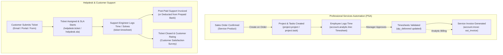

# Professional Services & Helpdesk (PSA & Support) End-to-End Business Flow

```
╔══════════════════════════════════════════════════════════════════════════════╗
║  PROFESSIONAL SERVICES & HELPDESK BUSINESS PROCESS LIFECYCLE                 ║
║  From Service Contracts to Task Timesheets, Billing & SLA Resolution         ║
║  Standard Odoo Functional Process Map & Inter-Module Automation              ║
╚══════════════════════════════════════════════════════════════════════════════╝
```

## 1. High-Level Process Architecture

The **Professional Services & Helpdesk** cycle governs client project execution, labor time recording, service invoicing policies, and post-delivery customer support ticketing with strict Service Level Agreements (SLAs).



---

## 2. Stage-by-Stage Functional Breakdown

### Phase 1: Service Product Invoicing Policies

Configured on the Product detail form (**Product Type = Service**):

| Invoicing Policy | Service Pricing Model | Delivery & Invoicing Mechanism | Typical Business Use Case |
|---|---|---|---|
| **Prepaid / Fixed Price** | Fixed Price Milestone | Invoice generated **before** work starts (or by milestone % completion). | Fixed-bid IT development, retainer fees, architect designs. |
| **Based on Timesheets** | Time & Materials (T&M) | Invoice generated **after** timesheets are logged. `qty_delivered` = Total Approved Timesheet Hours. | Legal consulting, ad-hoc programming, hourly audits. |
| **Based on Milestones** | Deliverables-based | Invoicing triggers manually as project milestones are achieved. | Construction phases, turnkey equipment commissioning. |

#### "Create on Order" Settings
When the Sales Order is confirmed, Odoo automatically executes:
- **Project & Task**: Creates a dedicated project named after the SO and an initial task.
- **Task**: Appends a new task to an existing master project.
- **Project**: Creates an empty project workspace.
- **Nothing**: Standard service without automated project generation.

---

### Phase 2: Project Management & Task Execution (`project`)

1. **Project Workspace (`project.project`)**:
   - Assigns Project Manager, Customer, Privacy rules (Portal access vs Internal only), and linked Analytic Account.
2. **Task Board (`project.task`)**:
   - Kanban stages (e.g., `Backlog` ➔ `In Progress` ➔ `Code Review` ➔ `Completed`).
   - Planned hours allocated vs remaining hours.
   - Subtasks, dependencies, and project milestones tracking.

---

### Phase 3: Labor Timesheet Logging & Approval (`hr_timesheet`)

1. **Logging Working Hours (`account.analytic.line`)**:
   - Recorded via mobile app, desktop stopwatch widget, or weekly grid view (`timesheet_grid`).
   - Each entry links: Date, Employee, Project, Task, Description, and Duration.
2. **Timesheet Validation & Manager Approval**:
   - Project manager or department lead reviews logged hours.
   - Validating hours updates the Sales Order line:
     $$\text{Delivered Quantity} = \sum \text{Approved Timesheet Hours}$$
3. **Invoicing Client (`account.move`)**:
   - In Sales Order, click **Create Invoice**.
   - Select **Timesheet Period** to invoice only hours logged within specific billing cycles (e.g. November 1–30).
   - Generates detailed invoice with line items reflecting employee hourly rates and task breakdown.

---

### Phase 4: Helpdesk & SLA Support Pipeline (`helpdesk`)

1. **Ticket Ingestion (`helpdesk.ticket`)**:
   - Inbound channels: Support email alias (`support@company.com`), Website portal ticket form, Live chat, or phone log.
   - Auto-assigned to Support Teams based on round-robin or load-balancing rules.
2. **Service Level Agreement (SLA) Policies (`helpdesk.sla`)**:
   - Enforces contractual turnaround times based on ticket priority and customer tier:
     - **Time to First Response**: (e.g. < 1 hour for Urgent tickets).
     - **Time to Resolution**: (e.g. < 8 hours for VIP customers).
   - Real-time SLA status banner: **In Progress**, **Failed**, or **Reached**.
3. **Billable Support Tickets (Track & Bill Time)**:
   - **Prepaid Support (Hour Bank)**: Customer purchases a 20-hour support pack upfront. Ticket timesheets automatically deduct from customer's remaining hour balance.
   - **Post-Paid Support**: Support engineer tracks time spent fixing the issue. Clicking **Sales Order ‣ Create Invoice** bills the customer for hours worked.
4. **Ticket Closure & Customer Satisfaction (CSAT)**:
   - Ticket solved ➔ Auto-email survey sent (`Bad`, `Neutral`, `Happy`).
   - Performance metrics reflected in Helpdesk Team dashboard.

---

## 3. Version-Specific Differences (v14 – v20)

| Area | Odoo 14 – 15 | Odoo 16 – 17 | Odoo 18 – 20 |
|---|---|---|---|
| **Project Sharing Portal** | Basic portal view of tasks. | Collaborative live task editing & commenting for external clients. | Granular read/write permissions per task stage on customer portal. |
| **Timesheets Grid View** | Standard list and basic matrix. | Enhanced weekly grid view (`timesheet_grid`) with timer widget. | Instant employee capacity forecast vs actual logged hours. |
| **Milestone Invoicing** | Manual percentage calculation. | Direct milestone tracking linked to task completion. | Automated milestone invoice triggers upon project deliverable approval. |
| **Helpdesk Ticket to Task** | Manual creation. | One-click conversion from ticket to project task with timesheet sync. | Automated SLA escalation re-routing to senior engineering tiers. |

