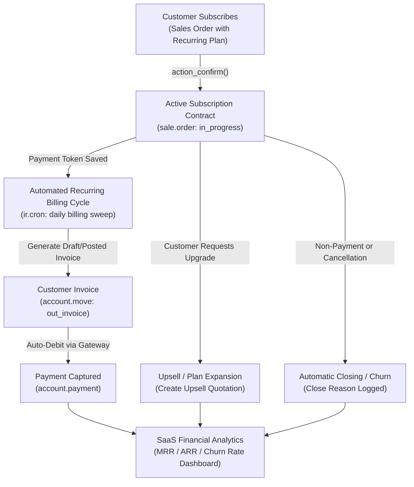

# Subscriptions & Recurring Revenue Contracts End-to-End Business Flow

```
╔══════════════════════════════════════════════════════════════════════════════╗
║  SUBSCRIPTIONS & RECURRING CONTRACTS BUSINESS PROCESS LIFECYCLE              ║
║  Recurring Billing Plans, Payment Auto-Debit, Upselling & Churn Analytics     ║
║  Standard Odoo Functional Process Map & Inter-Module Automation              ║
╚══════════════════════════════════════════════════════════════════════════════╝
```

## 1. High-Level Process Architecture

The **Subscriptions** application in Odoo manages recurring revenue streams (SaaS, Retainers, Maintenance Contracts, Subscription Boxes), automating periodic billing, payment card auto-debits, plan upgrades, and customer lifetime value (LTV / MRR / ARR) analytics.



---

## 2. Stage-by-Stage Functional Breakdown

### Phase 1: Recurring Plan Configuration (`sale.subscription.plan`)

Configured under **Subscriptions ‣ Configuration ‣ Recurring Plans**:

1. **Billing Period**:
   - Frequency: Daily, Weekly, Monthly, Quarterly, or Annually.
2. **Align to Period Start**:
   - Automatically synchronizes billing to the 1st of every calendar month.
   - **Mid-month Pro-rating**: If a client subscribes on July 15, the first invoice charges a pro-rated amount for July 15–31, and full monthly billing commences on August 1.
3. **Automatic Closing**:
   - Number of grace period days before an overdue subscription is automatically closed (e.g. 15 days after failed payment).
4. **Self-Service Portal Permissions**:
   - Allow customers to upgrade, pause, or cancel subscriptions directly from the Odoo Customer Portal.

---

### Phase 2: Subscription Initiation & Tokenization

1. **Sales Order with Subscription Products**:
   - Standard `sale.order` with a linked `plan_id` (e.g. Monthly SaaS License).
   - Can combine recurring lines (Software access) and one-time lines (Onboarding setup fee).
2. **Payment Tokenization (`payment.token`)**:
   - Customer pays initial quotation online via integrated gateway (Stripe, Adyen, Authorize.Net).
   - Gateway securely stores customer credit card token in Odoo.
   - Order confirmation transitions contract status to **In Progress** (`in_progress`).

---

### Phase 3: Automated Recurring Invoicing & Auto-Debit

The automated background cron (`ir.cron` Subscription Invoicing) executes daily:

1. **Invoice Generation**:
   - Evaluates all active subscriptions where `next_invoice_date <= Today`.
   - Generates a balanced customer invoice (`account.move`).
2. **Automated Payment Capture**:
   - Odoo charges the stored `payment.token` through the payment provider API without requiring customer manual intervention.
   - **Payment Success**:
     - Advances `next_invoice_date` by one billing cycle (e.g. +1 month).
     - Sends invoice receipt PDF via email.
   - **Payment Failure (Dunning Process)**:
     - Retries payment according to dunning intervals.
     - Sends automated payment reminder email with secure portal link to update expired credit card.
     - Auto-closes subscription if payment fails past `automatic_closing` threshold.

---

### Phase 4: Customer Lifecycle Operations (Upselling, Renewals & Churn)

1. **Upselling / Contract Expansion**:
   - Client requests adding 5 extra user seats midway through the term.
   - Clicking **Upsell** generates a pro-rated add-on quotation linked to the master subscription.
   - Once confirmed, extra seats are merged into future recurring billing cycles.
2. **Renewal Handling**:
   - For fixed-term contracts (e.g. 1-Year Commitment), renewal reminders are dispatched 30 days before contract expiry.
   - Generates renewal quotation for customer review and digital signature.
3. **Cancellation & Churn Analysis**:
   - Customer terminates service or fails payment.
   - Mandatory **Close Reason** captured (e.g., *Too expensive*, *Missing feature*, *Switched to competitor*).
   - Tracks Net Churn vs Gross Retention.

---

## 3. SaaS Revenue Analytics & Key Performance Indicators (KPIs)

The Subscriptions dashboard aggregates real-time metrics:

| Metric | Business Definition | Odoo Calculation |
|---|---|---|
| **MRR (Monthly Recurring Revenue)** | Normalized monthly value of active recurring contracts. | Annual plans divided by 12; Weekly plans multiplied by 4.33. |
| **ARR (Annual Recurring Revenue)** | Annualized recurring revenue run rate. | $\text{MRR} \times 12$. |
| **Expansion MRR** | Additional recurring revenue from existing customers upgrading plans or adding seats. | $\sum (\text{New Plan MRR} - \text{Old Plan MRR})$. |
| **Churn MRR** | Lost recurring revenue due to cancelled or closed subscriptions. | Total MRR lost from churned contracts in period. |
| **Net MRR Growth** | Overall net subscription portfolio health. | $\text{New MRR} + \text{Expansion MRR} - \text{Churn MRR}$. |
| **Customer Lifetime Value (LTV)** | Predicted total revenue generated by a single subscriber. | $\frac{\text{Average Revenue Per Account (ARPU)}}{\text{Customer Churn Rate}}$. |

---

## 4. Version-Specific Differences (v14 – v20)

| Area | Odoo 14 – 15 | Odoo 16 – 17 | Odoo 18 – 20 |
|---|---|---|---|
| **Subscription Data Model** | Separate `sale.subscription` model with dedicated number sequence. | **Merged into `sale.order`**: Unified quotation and recurring contract. | Native pro-rated mid-month alignment and express recurring plans. |
| **Payment Tokenization** | Basic token storage via Authorize/Stripe. | Multi-provider inline tokenization with automatic dunning retries. | Automated customer credit card expiration alert and self-service token update. |
| **Portal Self-Service** | Customers could view invoices and request cancellation. | Direct self-service plan upgrade/downgrade from customer portal. | Automated immediate pro-rated charge on customer portal plan upgrade. |
| **MRR / ARR Analytics** | Basic Cohort and retention reports. | Interactive dynamic SaaS dashboard with expansion/contraction breakdown. | Real-time predictive churn risk indicators and automated customer retention emails. |

